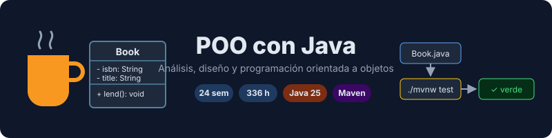

<p align="center">
  
</p>

<p align="center">
  <a href="LICENSE"></a>
  <a href="bootcamp/README.md"></a>
  <a href="bootcamp/README.md"></a>
  <a href="docs/stack-versions.md"></a>
  <a href="docs/stack-versions.md"></a>
</p>

---

## 📋 Descripción

Bootcamp de **24 semanas (~6 meses)** de análisis, diseño y programación orientada a objetos con **Java 25** y UML. Autoestudio asincrónico, **14 h/semana**, 100% práctico. Empiezas sin saber Java y terminas con un sistema de gestión propio, diseñado con UML, SOLID y patrones, probado y guardado en PostgreSQL.

### 🎯 Objetivos

Al finalizar el bootcamp serás capaz de:

- ✅ Escribir Java 25 moderno y probado con JUnit y AssertJ desde la primera semana
- ✅ Analizar un dominio y pasar de requisitos a clases
- ✅ Aplicar encapsulación, composición, herencia, polimorfismo e interfaces, y saber cuándo no
- ✅ Modelar con records, enums, tipos `sealed` y pattern matching
- ✅ Usar excepciones, colecciones, genéricos, lambdas y streams como un profesional
- ✅ Diseñar con diagramas UML, principios SOLID y patrones de diseño
- ✅ Persistir con JDBC en PostgreSQL y organizar el código en una arquitectura hexagonal

---

## 🗓️ Estructura

Cinco fases: Java base (01-04), POO (05-11), Java profesional (12-16), análisis y diseño (17-21) e integración (22-24). El temario semana a semana está en el **[índice de semanas](bootcamp/README.md)**.

Cada semana tiene la misma forma:

```
week-NN-tema/
├── README.md               # objetivos, contenidos y distribución de las 14 h
├── rubrica-evaluacion.md   # conocimiento 30% · desempeño 40% · producto 30%
├── 0-assets/               # diagramas SVG
├── 1-teoria/               # un concepto por archivo
├── 2-practicas/            # ejercicios guiados, sin entrega
├── 3-proyecto/             # el único entregable, en tu dominio
├── 4-recursos/             # webgrafía, videografía, ebooks libres
└── 5-glosario/             # términos de la semana
```

---

## 🚀 Inicio rápido

1. Prepara el entorno: [`docs/setup.md`](docs/setup.md) (JDK 25, Git y editor; Maven viene con cada proyecto).
2. Pide a tu instructor tu dominio: con él construyes el [proyecto hilo conductor](docs/proyecto-hilo-conductor.md).
3. Empieza por la [semana 01](bootcamp/README.md).

---

## 📊 Evaluación

Cada semana se evalúa con tres evidencias: **conocimiento** (cuestionario, 30%), **desempeño** (proceso en tu repositorio y sustentación, 40%) y **producto** (el proyecto de la semana, 30%). Se aprueba con un 70% en cada una. Los ejercicios guiados no se entregan.

---

## 📚 Documentación

| Documento | Para qué |
|---|---|
| [Preparar el entorno](docs/setup.md) | Instalar JDK 25, Git y el editor |
| [Versiones del stack](docs/stack-versions.md) | Versiones fijadas, con fecha y fuente |
| [Decisión de ritmo](docs/decision-semanas.md) | Por qué 24 semanas de 14 h y en este orden |
| [Proyecto hilo conductor](docs/proyecto-hilo-conductor.md) | Qué construyes en las 24 semanas |

---

## 📄 Licencia y conducta

[CC BY-NC-SA 4.0](LICENSE) · [Código de conducta](CODE_OF_CONDUCT.md) · [Seguridad](SECURITY.md)
