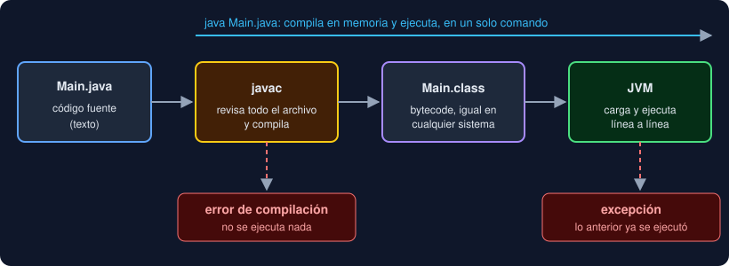

# 02 · Del código a la JVM

⏱️ 45 min

## 1. Dos fases: compilar y ejecutar



Java es un lenguaje **compilado a bytecode**:

1. **Compilar**: `javac Main.java` lee el archivo **entero**, comprueba que está bien escrito y que los tipos encajan, y genera `Main.class`. Ese archivo no es texto ni código máquina: es **bytecode**, un juego de instrucciones para una máquina que no existe físicamente.
2. **Ejecutar**: `java Main` arranca la **JVM**, que carga `Main.class` y ejecuta sus instrucciones. La JVM sí existe para cada sistema operativo; por eso el mismo `.class` funciona en Linux, macOS y Windows.

Para programas de un solo archivo, `java Main.java` hace las dos fases seguidas y no deja `.class` en disco (compila en memoria). Los ejercicios de este bootcamp usan esa forma; los proyectos usan Maven, que llama a `javac` por ti (teoría 03).

## 2. Dos familias de errores

La división en dos fases da dos tipos de error muy distintos:

| | Error de compilación | Excepción en ejecución |
|---|---|---|
| Cuándo | Al compilar, antes de ejecutar nada | Al llegar a la línea, con el programa en marcha |
| Quién lo detecta | `javac` | La JVM |
| Ejemplos | `';' expected`, `cannot find symbol`, `incompatible types` | `NumberFormatException`, `ArithmeticException: / by zero` |
| Qué se ejecutó | Nada | Todo lo anterior a la línea que falla |

El compilador de Java es estricto a propósito: cada error que detecta al compilar es un error que no llega a ejecutarse delante de un usuario. Aprende a **agradecer** los errores de compilación.

## 3. Leer un error de compilación

```
Main.java:7: error: ';' expected
    IO.println("Ejercicio 01 · Hola, Java")
                                           ^
1 error
```

Archivo y línea (`Main.java:7`), qué esperaba (`';' expected`), la línea copiada y un `^` donde se dio cuenta. A veces el error real está en la línea **anterior**: si te falta un `}` o unas comillas, el compilador se entera más abajo. Corrige **el primer error** y vuelve a compilar: los siguientes suelen ser consecuencia de él.

## 4. Leer un *stack trace*

```
Exception in thread "main" java.lang.NumberFormatException: For input string: "doce"
	at java.base/java.lang.NumberFormatException.forInputString(NumberFormatException.java:67)
	at java.base/java.lang.Integer.parseInt(Integer.java:565)
	at java.base/java.lang.Integer.parseInt(Integer.java:662)
	at Main.main(Main.java:31)
```

- **Primera línea**: el tipo de excepción (`NumberFormatException`) y el mensaje (`For input string: "doce"`). Es el **qué**.
- **Líneas `at`**: la pila de llamadas, de la más interna (arriba) a la más externa (abajo). `main` llamó a `parseInt`, que llamó a `forInputString`, que lanzó la excepción.
- **Tu línea**: la primera que no empieza por `java.base/`: `Main.java:31`. Es el **dónde**. El código de `java.base` es de la biblioteca estándar y casi nunca tiene el fallo.

## 5. Qué hace la JVM mientras ejecuta

La JVM empieza **interpretando** el bytecode y, mientras tanto, mide qué métodos se llaman más. Esos los compila a código máquina optimizado (**compilación JIT**, *just in time*). Por eso un programa Java arranca algo más lento que uno en C y, una vez "caliente", va igual de rápido. Además, la JVM gestiona la memoria por ti con el **recolector de basura** (*garbage collector*): no hay que liberar objetos a mano (lo verás en la semana 05).

## ✅ Comprueba que lo entendiste

1. ¿Qué contiene `Main.class` y quién lo ejecuta?
2. Un programa imprime tres líneas y en la cuarta lanza una excepción. ¿Ves las tres primeras? ¿Y si el fallo fuera un `;` olvidado en la cuarta?
3. En un *stack trace* de diez líneas, ¿cómo encuentras la línea de tu código que hay que revisar?

---

## 🔗 Navegación

| Anterior | Actual | Siguiente |
| -------- | ------ | --------- |
| [01 · Qué es Java hoy](01-que-es-java-hoy.md) | **02 · Del código a la JVM** | [03 · Maven y el wrapper](03-maven-y-el-wrapper.md) |
