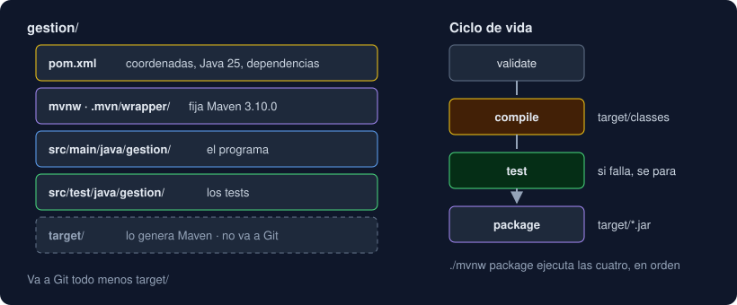

# 03 · Maven y el wrapper

⏱️ 55 min

## 1. Para qué sirve una herramienta de construcción

Con un archivo, `java Main.java` basta. Con cincuenta archivos, tests y dos bibliotecas externas, necesitas que alguien:

- descargue las bibliotecas (**dependencias**) en la versión correcta,
- compile todos los `.java` en orden con la versión de Java correcta,
- ejecute los tests y pare si alguno falla,
- empaquete el resultado.

Eso es **Maven**: una herramienta de construcción que hace todo eso a partir de un único archivo de configuración, `pom.xml`. La alternativa principal es Gradle; Maven es el más usado en proyectos Java empresariales y el que usarás en `bc-javaweb-sb`.

## 2. Anatomía de un proyecto



Maven usa **convención antes que configuración**: si pones el código donde espera, no hay que decirle nada.

| Ruta | Qué va ahí |
|---|---|
| `pom.xml` | La descripción del proyecto (POM = *Project Object Model*) |
| `src/main/java/` | El código del programa, una carpeta por paquete |
| `src/test/java/` | Los tests, con los mismos paquetes |
| `target/` | Lo que genera Maven: `.class`, informes, `.jar`. No se edita ni va a Git |

## 3. El `pom.xml`

Lo esencial del `pom.xml` de tu proyecto:

```xml
<groupId>dev.bootcamp</groupId>
<artifactId>gestion</artifactId>
<version>0.1.0</version>

<properties>
  <maven.compiler.release>25</maven.compiler.release>
</properties>

<dependency>
  <groupId>org.assertj</groupId>
  <artifactId>assertj-core</artifactId>
  <version>3.27.7</version>
  <scope>test</scope>
</dependency>
```

- **Coordenadas** (`groupId:artifactId:version`): el nombre único de tu proyecto. Las dependencias se piden con las suyas.
- **`maven.compiler.release`**: la versión de Java para la que se compila.
- **Dependencias**: Maven las descarga de **Maven Central** a tu caché `~/.m2/repository/` la primera vez; después las reutiliza. `scope` `test` significa que solo existen para los tests: tu programa no las lleva.
- **BOM** (*bill of materials*): el `junit-bom` del `dependencyManagement` fija la versión de todos los módulos de JUnit a la vez; por eso `junit-jupiter` no lleva `<version>`.
- **Plugins**: Maven no sabe compilar por sí mismo; lo hacen plugins (`maven-compiler-plugin`, `maven-surefire-plugin` para los tests). El curso fija también su versión.

## 4. El ciclo de vida

Maven tiene fases en orden fijo. Pedir una ejecuta **todas las anteriores**:

| Comando | Qué hace |
|---|---|
| `./mvnw compile` | Compila `src/main/java` en `target/classes` |
| `./mvnw test` | Compila también los tests y los ejecuta. Si uno falla: `BUILD FAILURE` |
| `./mvnw package` | Todo lo anterior y crea `target/<artifactId>-<version>.jar` |
| `./mvnw clean` | Borra `target/` (se combina: `./mvnw clean test`) |
| `./mvnw -q compile exec:java` | Compila y ejecuta el `main` de la clase indicada en el `pom.xml` (plugin `exec`) |

Que `package` dependa de `test` es una decisión de diseño: **no se empaqueta código con tests en rojo**.

## 5. El wrapper: `./mvnw`

Si cada persona instala "su" Maven, cada una tendrá una versión distinta. El **Maven Wrapper** lo resuelve:

- `mvnw` (Linux/macOS) y `mvnw.cmd` (Windows) son scripts que van **dentro del proyecto**.
- `.mvn/wrapper/maven-wrapper.properties` dice qué versión exacta usar (`3.10.0`).
- La primera vez, el script descarga esa versión a `~/.m2/wrapper/`; después la reutiliza.

Así, cualquiera que clone el proyecto ejecuta `./mvnw test` con el mismo Maven, sin instalar nada más que el JDK. Por eso en este curso **siempre** escribes `./mvnw`, nunca `mvn`.

## 6. Tests en el proyecto

Las dos dependencias de test del curso:

- **JUnit**: el *framework* que encuentra los métodos marcados con `@Test`, los ejecuta y cuenta cuántos pasan. Maven lo lanza en la fase `test` a través de Surefire.
- **AssertJ**: la biblioteca para escribir comprobaciones legibles: `assertThat(actual).isEqualTo(esperado)`. Si fallan, dice qué esperabas y qué obtuviste.

```java
@Test
void parseAmountWithComma() {
    assertThat(Fields.parseAmount("12,5")).isEqualTo(12.5);
}
```

La semana 03 profundiza en los tests; desde hoy, cada proyecto arranca **en rojo** (tests que fallan) y tu trabajo es ponerlo **en verde**.

## ✅ Comprueba que lo entendiste

1. ¿Qué significa `<scope>test</scope>` en una dependencia?
2. Ejecutas `./mvnw package` y un test falla. ¿Se genera el `.jar`? ¿Por qué está bien que sea así?
3. ¿Qué problema resuelve el wrapper que no resolvería instalar Maven con `apt`?

---

## 🔗 Navegación

| Anterior | Actual | Siguiente |
| -------- | ------ | --------- |
| [02 · Del código a la JVM](02-del-codigo-a-la-jvm.md) | **03 · Maven y el wrapper** | [04 · JShell y el primer programa](04-jshell-y-el-primer-programa.md) |
