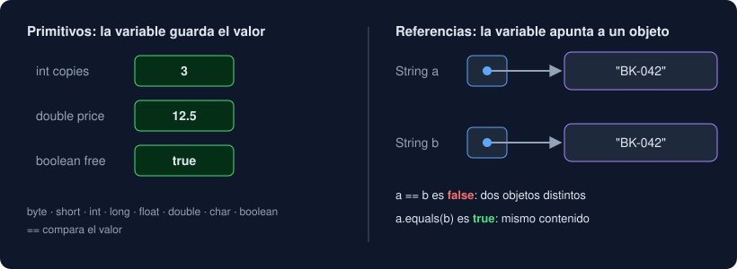

# 05 · Variables y tipos

⏱️ 1 h

## 1. Tipado estático

En Java, cada variable tiene un **tipo** fijo que se conoce al compilar:

```java
int copies = 3;
double price = 12.5;
String title = "Cien años de soledad";
copies = "tres";   // error: incompatible types: String cannot be converted to int
```

El compilador rechaza la última línea **antes** de ejecutar nada. Es el mismo principio de la teoría 02: más errores detectados al compilar, menos sorpresas con el programa en marcha.

## 2. Primitivos y referencias



Java tiene dos familias de tipos:

- **Primitivos**: la variable guarda el valor directamente. Son ocho, todos en minúscula.
- **Referencias**: la variable guarda una **flecha** hacia un objeto. `String` es el primero que usas; todas las clases que escribas desde la semana 05 también lo serán.

| Primitivo | Qué guarda | Rango o detalle | Cuándo |
|---|---|---|---|
| `int` | Entero, 32 bits | ±2 147 483 647 | Contar: copias, unidades, años |
| `long` | Entero, 64 bits | ±9,2 × 10¹⁸; literal con `L`: `3_000_000_000L` | Importes en céntimos, milisegundos, IDs grandes |
| `double` | Decimal, 64 bits | ~15 cifras significativas, **no exacto** | Medidas, precios de ejemplo |
| `boolean` | `true` o `false` | | Estados: disponible, activo |
| `char` | Un carácter Unicode | Comillas simples: `'B'` | Letras sueltas, códigos de una cifra |
| `byte`, `short`, `float` | Variantes pequeñas | | Casi nunca en código de negocio |

`String` (con mayúscula) **no** es primitivo: es una clase. Por eso tiene métodos (`"Ana".length()`, `strip()`, `toUpperCase()`) y por eso se compara con `equals`, no con `==`.

## 3. Sorpresas que debes conocer

| Expresión | Resultado | Por qué |
|---|---|---|
| `Integer.MAX_VALUE + 1` | `-2147483648` | *Overflow*: da la vuelta sin avisar |
| `0.1 + 0.2 == 0.3` | `false` | `double` es binario; `0.1` no es exacto. Compara con tolerancia: `Math.abs(a - b) < 1e-9` |
| `7 / 2` | `3` | Entre dos `int`, la división es entera |
| `(double) 7 / 2` | `3.5` | El casting va antes que la división |
| `(int) 4.99` | `4` | `(int)` trunca; para redondear, `Math.round` |
| `"1967" + 1` | `"19671"` | Con un `String` en un lado, `+` concatena |
| `new String("a") == "a"` | `false` | `==` compara referencias; usa `equals` |

Todas las ves en el ejercicio 03.

## 4. Conversiones

**Implícitas** (ensanchar, sin pérdida): `int` a `long`, `int` a `double`. Java las hace solo.

```java
long total = copies;      // int a long: sin problema
double avg = copies;      // int a double: 3.0
```

**Explícitas** (*casting*, con posible pérdida): hay que pedirlas.

```java
int whole = (int) 12.9;   // 12: pierdes los decimales y lo has pedido tú
```

**De texto a número**: lo que llega de un usuario o de un archivo es siempre `String`.

```java
int year = Integer.parseInt("1967");
double price = Double.parseDouble("12,5".replace(',', '.'));  // solo entiende punto
Integer.parseInt("doce");  // NumberFormatException, al ejecutar
```

**De número a texto**: con `+` o, mejor, con formato.

```java
String.format(Locale.ROOT, "%.2f", 12.5)   // "12.50"
String.format(Locale.ROOT, "%05d", 42)     // "00042"
String.format(Locale.ROOT, "%s: %.1f", "Peso", 2.25)  // "Peso: 2.3"
```

`Locale.ROOT` fija el punto decimal. Sin él, Java usa el idioma del sistema y en español escribiría `12,50`: tus tests pasarían en una máquina y fallarían en otra.

## 5. `var` y `final`

```java
var title = "Cien años de soledad";   // el compilador deduce String
final int MAX_COPIES = 10;            // no se puede reasignar
```

- `var` ahorra escribir el tipo cuando es **obvio** por la derecha. El tipo sigue fijo: `title = 5` es un error. Solo para variables locales.
- `final` impide reasignar. Úsalo para constantes y para dejar claro que un valor no cambia.

## 6. Métodos de `String` que usarás ya

| Método | Ejemplo | Resultado |
|---|---|---|
| `strip()` | `"  BK-042 ".strip()` | `"BK-042"` |
| `toUpperCase(Locale.ROOT)` | `"bk".toUpperCase(Locale.ROOT)` | `"BK"` |
| `replace(a, b)` | `"12,5".replace(',', '.')` | `"12.5"` |
| `isEmpty()` / `isBlank()` | `"  ".isBlank()` | `true` |
| `length()` | `"Ana".length()` | `3` |
| `equals(otro)` | `"BK".equals("bk")` | `false` |

Un `String` **no cambia nunca** (es inmutable): `strip()` no modifica el texto, devuelve uno nuevo. Por eso se encadenan: `text.strip().replace(',', '.')`.

## ✅ Comprueba que lo entendiste

1. ¿Por qué `price == 0.3` es una mala comparación si `price` es `double`?
2. ¿Qué dan `Integer.parseInt("4.5")`, `(int) 4.99` y `Math.round(4.5)`?
3. Tus tests pasan en tu máquina y fallan en la de un compañero con el sistema en inglés, o al revés. ¿Qué sospechas?

---

## 🔗 Navegación

| Anterior | Actual | Siguiente |
| -------- | ------ | --------- |
| [04 · JShell y el primer programa](04-jshell-y-el-primer-programa.md) | **05 · Variables y tipos** | [Ejercicio 01 · Hola, Java](../2-practicas/ejercicio-01-hola-java/README.md) |
