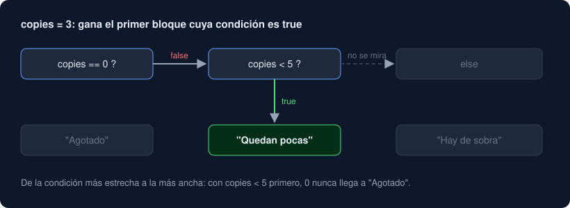

# 01 · Condicionales y `switch`

⏱️ 45 min

## 1. Decidir

Hasta ahora tus programas ejecutaban todas las líneas de arriba abajo. Un **condicional** ejecuta un bloque solo si se cumple una condición, una expresión de tipo `boolean`.

```java
if (copies == 0) {
    IO.println("Agotado");
} else if (copies < 5) {
    IO.println("Quedan pocas");
} else {
    IO.println("Hay de sobra");
}
```



- Las condiciones se evalúan **en orden**, y solo se ejecuta el primer bloque cuya condición es `true`.
- `else if` y `else` son opcionales.
- Pon **siempre** llaves, aunque el bloque tenga una sola línea: sin ellas, solo la primera línea pertenece al `if`, y la segunda se ejecuta siempre aunque la sangría diga lo contrario.

## 2. El orden importa

Como gana el primero que se cumple, las condiciones **estrechas** van antes que las anchas:

```java
if (copies < 5) { ... }          // 0 también es < 5: gana este
else if (copies == 0) { ... }    // nunca se llega aquí
```

Compila sin problemas. El compilador no sabe qué querías: solo un test lo descubre (ejercicio 01, paso 6).

## 3. Comparar y combinar

| Operador | Significa | Ejemplo |
|---|---|---|
| `==`, `!=` | Igual, distinto (primitivos) | `copies == 0` |
| `<`, `<=`, `>`, `>=` | Orden | `price <= 500` |
| `&&` | Y: las dos | `active && price < 15` |
| `\|\|` | O: al menos una | `price <= 0 \|\| price > 500` |
| `!` | No | `!active` |
| `.equals(...)` | Igual contenido (objetos, `String`) | `day.equals("SAT")` |

`&&` y `||` hacen **cortocircuito**: si con la parte izquierda ya se sabe el resultado, la derecha no se evalúa. Por eso esto es seguro aunque `code` sea `null`:

```java
if (code != null && code.length() == 6) { ... }
```

`null` significa "esta variable de referencia no apunta a ningún objeto". Llamar a un método sobre `null` lanza `NullPointerException`.

## 4. `switch` como expresión

Cuando comparas **un** valor con varias constantes, `switch` se lee mejor que una cadena de `if`:

```java
String schedule = switch (day) {
    case "MON", "TUE", "WED", "THU", "FRI" -> "9:00-18:00";
    case "SAT" -> "10:00-14:00";
    case "SUN" -> "Cerrado";
    default -> "Día desconocido";
};
```

- Es una **expresión**: produce un valor, y termina en `;`.
- Cada caso usa `->`, sin `break`, y no "se cuela" al siguiente.
- Varias etiquetas, separadas por comas.
- Debe cubrir **todos** los valores posibles: con `String` o `int`, eso exige `default`. Si falta: `error: the switch expression does not cover all possible input values`.
- Funciona con `int`, `char`, `String` y, desde la semana 10, con enums y tipos `sealed`.

Si un caso necesita varias sentencias, va entre llaves y devuelve con `yield`:

```java
int days = switch (month) {
    case 4, 6, 9, 11 -> 30;
    case 2 -> {
        IO.println("Febrero: depende del año");
        yield 28;
    }
    default -> 31;
};
```

Verás en código antiguo el `switch` con `case X:` y `break;`. Funciona, pero si olvidas un `break` el caso se cuela en el siguiente: usa siempre la forma con flechas.

## 5. El ternario

```java
String word = stock == 1 ? "copia" : "copias";
```

`condición ? siVerdad : siFalso` elige entre dos valores dentro de una expresión. Para dos opciones simples, es lo más corto; para tres o más, no anides ternarios: usa `switch` o `if`.

## ✅ Comprueba que lo entendiste

1. `copies` vale `0`. ¿Qué imprime una cadena que pregunta primero `copies < 5` y después `copies == 0`? ¿Cómo la arreglas?
2. ¿Por qué `code.length() == 6 && code != null` puede lanzar `NullPointerException` y `code != null && code.length() == 6` no?
3. ¿Por qué un `switch` expresión sobre un `String` exige `default`?

---

## 🔗 Navegación

| Anterior | Actual | Siguiente |
| -------- | ------ | --------- |
| [Semana 02](../README.md) | **01 · Condicionales y `switch`** | [02 · Bucles](02-bucles.md) |
