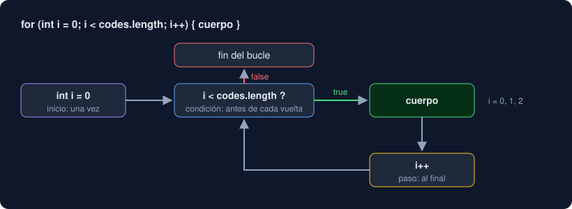

# 02 · Bucles

⏱️ 45 min

## 1. Repetir

Un **bucle** repite un bloque mientras se cumple una condición. Java tiene tres formas; las tres hacen lo mismo, cambia cuál se lee mejor en cada caso.



## 2. `while`

```java
int copies = 3;
while (copies > 0) {
    IO.println("Presto una");
    copies--;
}
```

Comprueba la condición **antes** de cada vuelta; si es `false` desde el principio, el cuerpo no se ejecuta nunca. Úsalo cuando no sabes cuántas vueltas habrá: "mientras queden copias", "mientras el usuario no escriba `salir`".

Algo dentro del cuerpo tiene que acabar haciendo `false` la condición. Si no, es un **bucle infinito**: el programa no termina y lo paras con `Ctrl+C`.

## 3. `for` clásico

```java
for (int i = 0; i < codes.length; i++) {
    IO.println(i + ": " + codes[i]);
}
```

Junta en una línea las tres piezas de un bucle con contador:

| Pieza | Aquí | Cuándo se ejecuta |
|---|---|---|
| Inicio | `int i = 0` | Una vez, antes de empezar |
| Condición | `i < codes.length` | Antes de cada vuelta |
| Paso | `i++` | Al final de cada vuelta |

`i` solo existe dentro del bucle. `i++` suma 1; `i--` resta 1; `sum += i` es `sum = sum + i`.

Úsalo cuando **necesitas la posición**: para leer dos arrays paralelos a la vez, para saber dónde está algo o para escribir en una posición.

## 4. for-each

```java
int total = 0;
for (int q : stock) {
    total += q;
}
```

Se lee "para cada `q` en `stock`". Recorre los valores, del primero al último, sin índice. Úsalo cuando solo necesitas **los valores**: sumar, contar, imprimir. Si necesitas la posición o escribir en el array, vuelve al `for` clásico.

## 5. `break`, `continue` y `return`

| Palabra | Qué hace |
|---|---|
| `break` | Sale del bucle ya |
| `continue` | Salta el resto de esta vuelta y pasa a la siguiente |
| `return` | Sale del **método** entero (y del bucle, de paso) |

```java
for (int i = 0; i < codes.length; i++) {
    if (codes[i].equals(wanted)) {
        return i;     // encontrado: no hace falta seguir
    }
}
return -1;            // el bucle terminó sin encontrarlo
```

Es el patrón **búsqueda lineal**: recorrer hasta encontrar, o devolver un valor que signifique "no está". Es `indexOf` de tu proyecto.

## 6. Tres patrones que usarás siempre

| Patrón | Idea | Ejemplo |
|---|---|---|
| Acumulador | Variable fuera del bucle, se actualiza dentro | Sumar cantidades |
| Contador | Como el acumulador, pero suma 1 si se cumple algo | Cuántos agotados |
| Búsqueda | Recorre y sale al encontrar | Posición de un código |

## ✅ Comprueba que lo entendiste

1. ¿Cuántas veces se ejecuta el cuerpo de `while (copies > 0)` si `copies` empieza en `0`?
2. Para sumar los valores de un array, ¿for clásico o for-each? ¿Y para imprimir cada código con su cantidad de un array paralelo?
3. En la búsqueda lineal, ¿por qué `return -1` va **después** del bucle y no en un `else` dentro de él?

---

## 🔗 Navegación

| Anterior | Actual | Siguiente |
| -------- | ------ | --------- |
| [01 · Condicionales y `switch`](01-condicionales-y-switch.md) | **02 · Bucles** | [03 · Métodos](03-metodos.md) |
