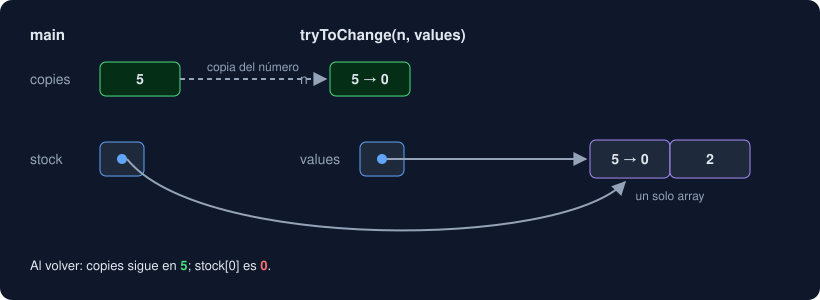

# 03 · Métodos

⏱️ 45 min

## 1. Para qué

Un **método** es un bloque de código con nombre que recibe datos, hace algo y, si quiere, devuelve un resultado. Sirve para tres cosas:

- **No repetir**: lo escribes una vez y lo llamas muchas.
- **Dar nombre** a una idea: `level(2, 8)` dice más que cuatro `if`.
- **Probar por partes**: cada test de tu proyecto llama a un método y comprueba su resultado.

## 2. Anatomía

```java
public static String level(int quantity, int capacity) {
    if (quantity == 0) {
        return "agotado";
    }
    ...
}
```

| Pieza | Aquí | Significa |
|---|---|---|
| Modificadores | `public static` | Visible desde fuera; se llama con el nombre de la clase (semanas 05 y 06) |
| Tipo de retorno | `String` | Qué devuelve. `void` si no devuelve nada |
| Nombre | `level` | Un verbo o una pregunta en `camelCase` |
| Parámetros | `(int quantity, int capacity)` | Qué recibe: tipo y nombre de cada uno |
| Cuerpo | `{ ... }` | Lo que hace |

`return` entrega el valor y **termina** el método. Un método que no es `void` debe devolver algo por todos los caminos; si no, `error: missing return statement`.

Al llamarlo, los **argumentos** se copian en los parámetros por orden: `level(2, 8)` hace `quantity = 2` y `capacity = 8`.

## 3. Sobrecarga

Dos métodos pueden llamarse igual si sus parámetros son distintos (en número o en tipo). Java elige por los argumentos:

```java
String label(String code) {
    return "[" + code + "]";
}

String label(String code, int copies) {
    return label(code) + " x" + copies;   // reutiliza el otro
}
```

El tipo de retorno no cuenta: dos métodos con los mismos parámetros y distinto retorno no compilan.

## 4. Java pasa copias



Cuando llamas a un método, cada parámetro recibe una **copia** de lo que guarda el argumento:

- Si es un **primitivo**, la copia es el número. Cambiarlo dentro del método no afecta a quien llamó.
- Si es una **referencia** (un array, un objeto), la copia es la flecha. Las dos flechas apuntan al **mismo** objeto: si el método cambia el contenido del array, quien llamó lo ve.

```java
void tryToChange(int n, int[] values) {
    n = 0;          // cambia la copia: copies sigue igual
    values[0] = 0;  // cambia el array compartido: stock[0] sí cambia
}
```

Esto tiene un nombre: Java pasa **siempre por valor**, pero el valor de una referencia es una flecha. Consecuencia práctica: si tu método no debe modificar el array que recibe (como `missing` en el proyecto), crea uno nuevo y devuélvelo.

## 5. Ámbito

Una variable vive dentro del bloque `{ }` donde se declara. Los parámetros y las variables de un método no existen fuera de él, y dos métodos pueden tener variables con el mismo nombre sin que se pisen. Por eso `i` de un `for` no existe después del bucle.

## 6. Métodos pequeños

Una regla para empezar: si un método no cabe en tu pantalla o necesitas un comentario para explicar qué hace cada trozo, probablemente son dos métodos. `report` del proyecto no recalcula el nivel: **llama** a `level`.

## ✅ Comprueba que lo entendiste

1. ¿Qué devuelve `void`? ¿Puede un método `void` tener `return`?
2. Llamas a `tryToChange(copies, stock)` con `copies = 5` y `stock = {5, 2}`. ¿Cuánto valen después `copies` y `stock[0]`? ¿Por qué distinto?
3. ¿Compilan juntos `int total(int[] a)` y `double total(int[] a)`? ¿Por qué?

---

## 🔗 Navegación

| Anterior | Actual | Siguiente |
| -------- | ------ | --------- |
| [02 · Bucles](02-bucles.md) | **03 · Métodos** | [04 · `String` y `StringBuilder`](04-string-y-stringbuilder.md) |
