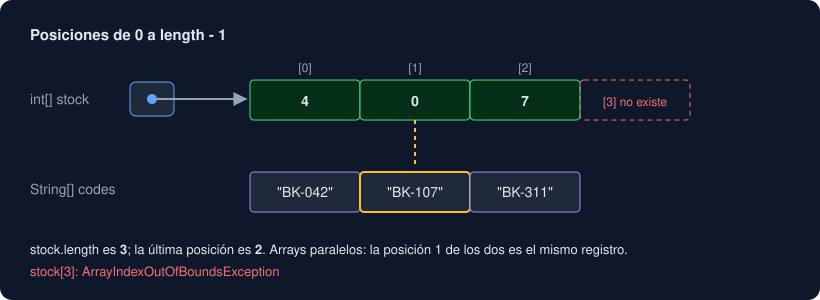

# 05 · Arrays

⏱️ 1 h

## 1. Varios valores, una variable

Un **array** guarda un número **fijo** de valores del mismo tipo, uno detrás de otro. Cada uno se alcanza por su posición (**índice**), de `0` a `length - 1`.



```java
int[] stock = {4, 0, 7};              // con valores
String[] codes = new String[3];       // vacío: [null, null, null]
int[] counts = new int[5];            // vacío: [0, 0, 0, 0, 0]
```

| Operación | Código | Resultado |
|---|---|---|
| Leer | `stock[0]` | `4` |
| Escribir | `stock[1] = 9` | `[4, 9, 7]` |
| Tamaño | `stock.length` | `3` (sin paréntesis: es un campo, no un método) |
| Último | `stock[stock.length - 1]` | `7` |
| Fuera | `stock[3]` | `ArrayIndexOutOfBoundsException` |

Un array creado con `new` empieza con el **valor por defecto** de su tipo: `0` para números, `false` para `boolean`, `null` para referencias.

El tamaño no cambia: para "añadir" un elemento hay que crear un array más grande y copiar. Ese es el problema que resolverá `List` en la semana 13. Las llaves solas (`{4, 0, 7}`) solo valen al declarar; después, `stock = new int[] {4, 0, 7};`.

## 2. Un array es un objeto

La variable `stock` no guarda los números: guarda una **flecha** hacia el array (como `String`, teoría 05 de la semana 01). Consecuencias:

```java
int[] alias = stock;      // copia la flecha: las dos apuntan al mismo array
alias[1] = 99;            // stock[1] también es 99
stock == alias            // true: mismo objeto
```

Para copiar los datos, crea un array nuevo:

```java
int[] copy = Arrays.copyOf(stock, stock.length);
```

Y cuando un método recibe un array, recibe una copia de la flecha: puede cambiar tu array (teoría 03).

## 3. `java.util.Arrays`

Para lo que se hace siempre, la biblioteca estándar ya tiene un método. Necesita `import java.util.Arrays;`.

| Método | Qué hace |
|---|---|
| `Arrays.toString(a)` | `"[4, 0, 7]"`. Sin él, `IO.println(a)` imprime algo como `[I@1b6d3586` |
| `Arrays.copyOf(a, n)` | Array nuevo con los `n` primeros (rellena con el valor por defecto si `n` es mayor) |
| `Arrays.sort(a)` | Ordena **ese** array de menor a mayor |
| `Arrays.equals(a, b)` | `true` si tienen el mismo contenido. `a == b` compara flechas |
| `Arrays.fill(a, v)` | Pone `v` en todas las posiciones |

## 4. Arrays paralelos

Para guardar datos de varios registros sin tener todavía clases, se usan dos (o más) arrays del mismo tamaño en los que la posición `i` corresponde al mismo registro:

```java
String[] codes   = {"BK-042", "BK-107", "BK-311"};
int[] quantities = {4,        0,        7};
// el BK-107 tiene 0 unidades
```

Se recorren con el **mismo índice**: `codes[i]` y `quantities[i]`. Funciona, pero es frágil: si ordenas uno y no el otro, o añades a uno y no al otro, los datos se mezclan sin avisar. En la semana 05 cada par será un objeto (`new Book("BK-042", 4)`) y este problema desaparece. Mientras, es lo que usa tu proyecto.

## 5. Recorrer, buscar, transformar

Los tres patrones de la teoría 02, sobre arrays:

```java
// acumular
int total = 0;
for (int q : quantities) { total += q; }

// buscar
for (int i = 0; i < codes.length; i++) {
    if (codes[i].equals("BK-107")) { return i; }
}
return -1;

// transformar en uno nuevo
int[] doubled = new int[quantities.length];
for (int i = 0; i < quantities.length; i++) {
    doubled[i] = quantities[i] * 2;
}
```

Fíjate en la condición: `i < length`, nunca `i <= length`. Es el error más frecuente con arrays (ejercicio 02, paso 6).

## 6. `String[] args`

El `main` clásico recibe un array: los argumentos de la línea de comandos. Con `java Main.java BK-042 3`, `args` es `["BK-042", "3"]`, siempre `String`: el `3` se convierte con `Integer.parseInt(args[1])`. Si no pasas argumentos, `args.length` es `0`.

## 7. Arrays de dos dimensiones

Un `int[][]` es un array de arrays: `int[][] shelves = new int[3][4];` tiene 3 filas de 4. Se lee `shelves[fila][columna]`. Úsalos para tableros o tablas fijas; casi nunca en código de negocio.

## ✅ Comprueba que lo entendiste

1. ¿Qué contiene `new String[2]` recién creado? ¿Y `new int[2]`?
2. `int[] b = a; b[0] = 1;`. ¿Cambia `a[0]`? ¿Y si hubieras hecho `int[] b = Arrays.copyOf(a, a.length);`?
3. ¿Por qué ordenar `codes` con `Arrays.sort` rompe tus arrays paralelos?

---

## 🔗 Navegación

| Anterior | Actual | Siguiente |
| -------- | ------ | --------- |
| [04 · `String` y `StringBuilder`](04-string-y-stringbuilder.md) | **05 · Arrays** | [Ejercicio 01 · Condicionales y `switch`](../2-practicas/ejercicio-01-condicionales-y-switch/README.md) |
