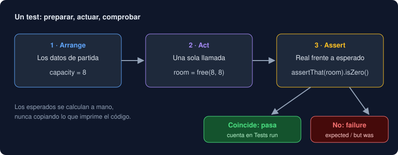

# 01 · Qué es un test y cómo lo ejecuta JUnit

⏱️ 45 min

## 1. Para qué sirve un test

Un **test** es un método que llama a tu código con unos datos conocidos y comprueba que el resultado es el esperado. Lo escribes una vez y lo ejecutas mil: cada vez que cambias algo, `./mvnw test` te dice en segundos si has roto lo que ya funcionaba.

Desde la semana 01 tu proyecto arranca en rojo y lo pones en verde. Hasta ahora los tests te los daban hechos; esta semana aprendes a leerlos, a escribirlos y a fiarte de ellos.

Un test te aporta tres cosas:

- **Una especificación que se ejecuta**: `assertThat(Stock.level(2, 8)).isEqualTo("bajo")` dice qué debe hacer `level` mejor que un comentario.
- **Una red al cambiar código**: si un arreglo rompe otro caso, lo sabes antes de entregarlo.
- **Un sitio donde reproducir un error**: un fallo que puedes repetir con un comando es un fallo a medio arreglar.

## 2. Anatomía: preparar, actuar, comprobar



```java
@Test
void fullShelfHasNoRoom() {
    // Arrange: los datos de partida
    int capacity = 8;

    // Act: la llamada que se prueba
    int room = Shelf.free(capacity, capacity);

    // Assert: el resultado esperado
    assertThat(room).isZero();
}
```

| Parte | Qué hace | Regla |
|---|---|---|
| **Arrange** | Prepara los datos | Valores concretos que puedas calcular a mano |
| **Act** | Llama al método que pruebas | Una sola llamada |
| **Assert** | Compara el resultado con lo esperado | Comprueba una idea (puede llevar varias aserciones encadenadas) |

En tests cortos las tres partes caben en una línea, como `assertThat(Shelf.free(10, 3)).isEqualTo(7);`. Separarlas sirve cuando la preparación ocupa varias líneas.

## 3. JUnit: quién ejecuta los tests

**JUnit** es la biblioteca de tests estándar en Java. Tu `pom.xml` usa la versión 6 (su motor se llama **Jupiter**). Las piezas que verás:

| Pieza | Para qué |
|---|---|
| `@Test` | Marca un método como test. Sin ella, JUnit lo ignora |
| `@DisplayName("...")` | Un nombre legible para el informe de tu editor |
| `class ShelfTest` | La clase de tests: se llama como la clase que prueba, con `Test` al final, y vive en `src/test/java`, en el mismo paquete |
| `void` y sin parámetros | Un test normal no recibe nada ni devuelve nada |

La clase y los métodos de test no necesitan `public`. Sí necesitan los `import` del principio: sin ellos, `@Test` o `assertThat` no compilan.

Quien lanza JUnit al hacer `./mvnw test` es **Surefire**, el plugin de Maven para tests. Busca las clases que terminan en `Test` dentro de `src/test/java`, ejecuta sus métodos `@Test` y resume:

```
[INFO] Tests run: 8, Failures: 0, Errors: 0, Skipped: 0
[INFO] BUILD SUCCESS
```

## 4. Ejecutar solo una parte

Con muchos tests, ejecutar solo los que te interesan ahorra tiempo:

| Quiero | Comando |
|---|---|
| Todos | `./mvnw test` |
| Una clase | `./mvnw test -Dtest=ShelfTest` |
| Un método | `./mvnw test -Dtest="ShelfTest#freeRoom"` |
| Los métodos que empiezan por `free` | `./mvnw test -Dtest="ShelfTest#free*"` |
| Dos clases | `./mvnw test -Dtest="FieldsTest+StockTest"` |

Las comillas evitan que la terminal interprete `#` o `*` antes de que llegue a Maven.

## 5. Tres resultados posibles

| Resultado | Qué pasó | Cómo se ve |
|---|---|---|
| **Pasa** | Todas las aserciones se cumplieron | Cuenta en `Tests run` y nada más |
| **Failure** | Una aserción no se cumplió: el código devolvió otra cosa | `<<< FAILURE!` y `expected: ... but was: ...` |
| **Error** | Saltó una excepción que nadie esperaba, como `NullPointerException` o el `UnsupportedOperationException` de un *stub* | `<<< ERROR!` y la excepción con su *stack trace* |

Un *failure* dice "el resultado es incorrecto"; un *error* dice "ni siquiera llegó a dar un resultado". Los dos ponen el *build* en rojo.

## 6. `assertEquals` frente a `assertThat`

JUnit trae sus propias aserciones:

```java
assertEquals("BK-042", Shelf.normalize(" bk-042 "));   // esperado, real
```

Funcionan, pero el orden de los argumentos se confunde con facilidad y el mensaje de fallo es escueto: `expected: <BK-42> but was: <BK-042>`. En este bootcamp usamos **AssertJ** (teoría 02), que se lee de izquierda a derecha: "afirmo que *esto* es igual a *aquello*". Reconoce `assertEquals` cuando lo veas en código ajeno.

## 7. Buenos nombres

El nombre de un test dice qué comportamiento comprueba, no qué método llama: `fullShelfHasNoRoom` o `rejectsNegativeDays`, no `test1` ni `testFree`. Cuando falle, el informe te mostrará ese nombre antes que nada.

## ✅ Comprueba que lo entendiste

1. Un test llama a un método que lanza `UnsupportedOperationException`. ¿Sale como *failure* o como *error*? ¿Por qué?
2. ¿Qué comando ejecuta solo los tests de `StockTest` cuyo nombre empieza por `level`?
3. ¿Qué tres partes tiene un test y qué hace cada una?

---

## 🔗 Navegación

| Anterior | Actual | Siguiente |
| -------- | ------ | --------- |
| [Semana 03](../README.md) | **01 · Qué es un test** | [02 · AssertJ](02-assertj.md) |
