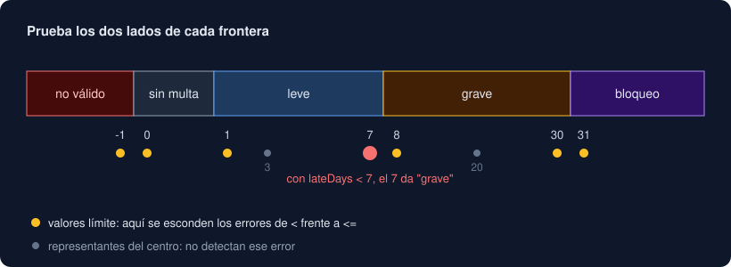

# 03 · Tests parametrizados y casos límite

⏱️ 45 min

## 1. El mismo test con otros datos

Estos tres tests solo cambian en los datos:

```java
@Test void noDelayHasNoFine()     { assertThat(Fine.category(0)).isEqualTo("sin multa"); }
@Test void threeDaysIsMinor()     { assertThat(Fine.category(3)).isEqualTo("leve"); }
@Test void twentyDaysIsSerious()  { assertThat(Fine.category(20)).isEqualTo("grave"); }
```

Un **test parametrizado** los junta: un método con parámetros y una tabla de datos. JUnit lo ejecuta una vez por fila.

```java
@ParameterizedTest
@CsvSource({
    "0,  sin multa",
    "3,  leve",
    "20, grave",
    "45, bloqueo"
})
void categoryByDays(int days, String expected) {
    assertThat(Fine.category(days)).isEqualTo(expected);
}
```

Cuatro ejecuciones, cuatro tests en `Tests run`. Añadir un caso es añadir una línea.

## 2. Las fuentes de datos

Todas se importan de `org.junit.jupiter.params.provider`.

| Anotación | Cuándo | Ejemplo |
|---|---|---|
| `@CsvSource` | Varios valores por fila: entrada y resultado esperado | `"5, 0.5, 10, 2.5"` |
| `@ValueSource` | Un valor por ejecución: `ints`, `doubles`, `strings`... | `@ValueSource(ints = {-1, -30})` |
| `@NullAndEmptySource` | Añade una ejecución con `null` y otra con `""` | Junto a `@ValueSource(strings = {"   "})` |

`@ParameterizedTest` sustituye a `@Test`: no se ponen las dos.

En `@CsvSource`, la coma separa columnas y JUnit convierte cada texto al tipo del parámetro (`"5"` a `int`, `"true"` a `boolean`). Los espacios alrededor se ignoran. Si el espacio importa, usa comillas simples:

| Fila | Valor del primer parámetro |
|---|---|
| `"' 12 ', 12"` | `" 12 "`, con los espacios |
| `"'', 0"` | `""`, el texto vacío |
| `", 0"` | `null` |
| `"'1,5', 0"` | `"1,5"`: entre comillas, la coma es parte del texto |

Un comentario con `//` al final de la fila, fuera de las comillas del texto, explica por qué está ese caso:

```java
"1, 15, 14, 0",   // el último día permitido
```

## 3. Qué casos probar: clases de equivalencia

No hace falta probar los 31 días de un mes. Agrupa las entradas que el código trata igual (**clases de equivalencia**) y prueba un representante de cada una:

| Clase | Entradas | Representante |
|---|---|---|
| Sin retraso | 0 | `0` |
| Leve | 1 a 7 | `3` |
| Grave | 8 a 30 | `20` |
| Bloqueo | más de 30 | `45` |
| No válida | negativos | `-1` |

Con los textos pasa igual. Pon un caso por cada **forma distinta** de equivocarse: corto (`"BK-42"`), minúsculas (`"bk-042"`), una letra donde va un dígito (`"BK-04A"`), sin guion (`"BK042X"`), con espacios (`" BK-042"`), `null`, vacío y en blanco. Diez textos demasiado cortos no prueban más que uno.

## 4. Los errores viven en los bordes



Un representante del centro de cada clase no detecta el error más común: un `<` donde iba un `<=`. Para eso están los **valores límite**: el primer y el último valor de cada clase.

```java
if (lateDays < 7) {      // la especificación dice "de 1 a 7"
    return "leve";
}
```

Con `3` y `20`, todo pasa. Con `7`, el test espera `"leve"` y el código devuelve `"grave"`. Por cada frontera de la especificación, prueba los dos lados: `7` y `8`, `30` y `31`, `0` y `1`, `-1` y `0`.

## 5. Calcula el esperado a mano

El resultado esperado de cada fila sale de la especificación y de una cuenta en papel, nunca de ejecutar el código y copiar lo que imprime. Si copias la salida del código, el test confirma el error en lugar de detectarlo.

## ✅ Comprueba que lo entendiste

1. Un método acepta edades de 18 a 65. ¿Qué valores límite pruebas?
2. ¿Qué valor recibe el parámetro con la fila `", 0"`? ¿Y con `"'', 0"`?
3. ¿Por qué `@CsvSource({"3, leve", "4, leve", "5, leve"})` no añade casi nada a una fila con `3`?

---

## 🔗 Navegación

| Anterior | Actual | Siguiente |
| -------- | ------ | --------- |
| [02 · AssertJ](02-assertj.md) | **03 · Tests parametrizados y casos límite** | [04 · Leer errores](04-leer-errores.md) |
