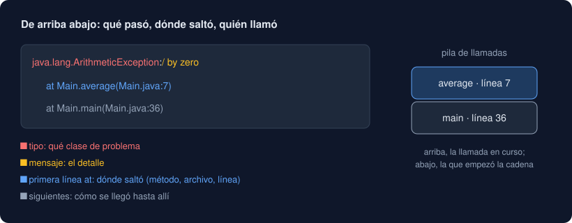

# 04 · Leer errores y *stack traces*

⏱️ 45 min

## 1. Tres momentos, tres tipos de error

| Momento | Quién avisa | Ejemplo | Tu programa... |
|---|---|---|---|
| Al compilar | `javac` (o `./mvnw compile`) | `error: cannot find symbol` | No llega a ejecutarse |
| Al ejecutar | La JVM, con una **excepción** | `ArithmeticException: / by zero` | Se para en esa línea |
| Al probar | JUnit, con un *failure* | `expected: 3 but was: 7` | Funciona, pero da un resultado incorrecto |

Los primeros son los más fáciles: el compilador dice archivo, línea y qué no entiende. Los últimos son los más peligrosos: sin un test, nadie se entera.

## 2. Anatomía de un *stack trace*

Cuando una excepción no la captura nadie, Java imprime su **stack trace**: la pila de llamadas que estaban en curso cuando falló.



```
Exception in thread "main" java.lang.ArithmeticException: / by zero
	at Main.average(Main.java:7)
	at Main.main(Main.java:36)
```

| Línea | Qué dice |
|---|---|
| `java.lang.ArithmeticException` | El **tipo** de excepción: qué clase de problema |
| `/ by zero` | El **mensaje**: el detalle |
| `at Main.average(Main.java:7)` | Dónde saltó: método `average`, archivo `Main.java`, línea 7 |
| `at Main.main(Main.java:36)` | Quién llamó a `average`: `main`, en la línea 36 |

La primera línea `at` es **donde** falló; las siguientes, **cómo se llegó allí**. Lee de arriba abajo hasta la primera línea que sea de tu código. En un test, debajo aparecen decenas de líneas de JUnit y Maven (`org.junit...`, `org.apache.maven...`): ignóralas.

Que salte en la línea 7 no quiere decir que el error esté en la 7. `average` divide entre `values.length`, y el array vacío vino de la línea 36. Decide tú dónde está el error: en `average`, que no contempla un array vacío, o en quien lo llamó con uno.

## 3. Las excepciones que verás más

| Excepción | Causa típica | Semana |
|---|---|---|
| `NullPointerException` | Llamar a un método sobre `null` | 01 |
| `ArrayIndexOutOfBoundsException` | `i <= length` en un bucle | 02 |
| `StringIndexOutOfBoundsException` | `substring` o `charAt` fuera del texto | 02 |
| `NumberFormatException` | `Integer.parseInt("12a")` | 01 |
| `ArithmeticException: / by zero` | Dividir enteros entre 0 (con `double` da `Infinity` o `NaN`) | 01 |
| `IllegalArgumentException` | Un método rechaza un argumento: la lanzas tú (teoría 02) | 03 |
| `UnsupportedOperationException` | Un *stub* del starter sin implementar | 01 |

## 4. `NullPointerException` te dice qué era `null`

```
java.lang.NullPointerException: Cannot invoke "String.toUpperCase()" because "<local6>" is null
	at Main.main(Main.java:47)
```

El mensaje dice qué llamada falló (`toUpperCase()`) y sobre qué (`<local6>`). Ves `<local6>` en lugar del nombre de la variable porque `java Main.java` compila sin información de depuración. En tu proyecto Maven el mensaje dice el nombre real, por ejemplo `because "code" is null`.

## 5. Un test rojo en Maven

```
[ERROR] Tests run: 14, Failures: 3, Errors: 0, Skipped: 0
...
[ERROR] Failures: 
[ERROR]   RulesTest.overdueDays:26 
expected: 0
 but was: -5
```

1. Mira el **resumen**: cuántos *failures* (resultado incorrecto) y cuántos *errors* (excepción inesperada).
2. Ve al **primero**: clase, método y línea del test.
3. En un parametrizado, el nombre lleva la fila: `overdueDays(int, int, int, int)[1]` es la primera fila del `@CsvSource`.
4. Lee el **esperado** y el **real** y calcula el caso a mano antes de tocar nada.

El informe completo de cada clase queda en `target/surefire-reports/`, por ejemplo `gestion.RulesTest.txt`, por si la salida de la terminal se te ha ido muy arriba.

## 6. Un error, un arreglo

Cuando hay muchos tests rojos, no los ataques todos a la vez. Arregla el primero, vuelve a ejecutar y mira cuántos quedan: un solo error suele romper varios tests.

## ✅ Comprueba que lo entendiste

1. En un *stack trace* con tres líneas `at`, ¿cuál dice dónde saltó la excepción y cuál quién empezó la cadena?
2. ¿Por qué un *failure* es más peligroso que un error de compilación?
3. ¿Qué significa `[3]` al final del nombre de un test que falla?

---

## 🔗 Navegación

| Anterior | Actual | Siguiente |
| -------- | ------ | --------- |
| [03 · Tests parametrizados y casos límite](03-tests-parametrizados-y-casos-limite.md) | **04 · Leer errores** | [05 · El depurador](05-el-depurador.md) |
