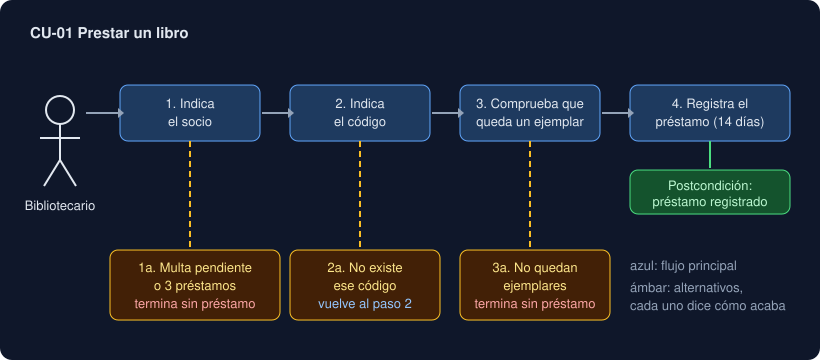

# 02 · Casos de uso

⏱️ 45 min

## 1. Qué es

Un requisito dice **qué** hace el sistema en una frase. Un **caso de uso** cuenta **cómo** lo usa alguien para conseguir un objetivo: la conversación paso a paso entre una persona y el sistema, incluidos los caminos en que algo sale mal.

| Término | Qué es | En la Biblioteca |
|---|---|---|
| **Actor** | Quien usa el sistema desde fuera: una persona con un papel u otro sistema | Bibliotecario, socio |
| **Objetivo** | Lo que el actor quiere conseguir; da nombre al caso de uso, con un verbo | Prestar un libro |
| **Precondición** | Lo que ya debe ser cierto antes de empezar | El libro y el socio están registrados |
| **Flujo principal** | Los pasos cuando todo va bien, numerados | 1, 2, 3, 4 |
| **Flujo alternativo** | Lo que pasa cuando un paso no va bien; se numera con el paso y una letra | 3a: no quedan ejemplares |
| **Postcondición** | Lo que es cierto al terminar el flujo principal | El préstamo queda registrado |

## 2. Un caso de uso completo



```
CU-01  Prestar un libro
Actor:          Bibliotecario
Requisitos:     RF-03, RF-06
Precondición:   El libro y el socio están registrados.

Flujo principal
  1. El bibliotecario indica el socio.
  2. El bibliotecario indica el código del libro.
  3. El sistema comprueba que queda un ejemplar disponible.
  4. El sistema registra el préstamo con fecha de devolución a 14 días (RN-01)
     y descuenta un ejemplar.

Flujos alternativos
  1a. El socio tiene una multa pendiente o ya tiene 3 préstamos (RN-03):
      el sistema lo indica y el caso de uso termina sin préstamo.
  2a. No existe un libro con ese código:
      el sistema lo indica y vuelve al paso 2.
  3a. No quedan ejemplares:
      el sistema lo indica y el caso de uso termina sin préstamo.

Postcondición:  Hay un préstamo nuevo y un ejemplar menos de ese libro.
```

Fíjate en cómo se escribe:

- **Un paso, una acción**, con sujeto: "El bibliotecario indica...", "El sistema comprueba...". Si un paso tiene dos verbos, probablemente son dos pasos.
- **Sin pantallas ni botones**: "indica el código", no "escribe el código en la caja y pulsa Aceptar". El caso de uso describe el problema, no la interfaz; sirve igual para la terminal de hoy que para una web mañana.
- **Cada alternativo dice cómo termina**: vuelve a un paso o acaba el caso de uso.

## 3. Encontrar los flujos alternativos

Los flujos alternativos son la parte valiosa: el flujo principal se le ocurre a cualquiera. Recorre cada paso y pregúntate:

- ¿Y si el dato **no existe**? (2a)
- ¿Y si está **mal escrito**? Un código en minúsculas o con espacios, `" bk-042 "`.
- ¿Y si **no queda** lo que se pide? (3a)
- ¿Y si una **regla** lo impide? (1a)

Son las mismas preguntas que te hacías al buscar clases de equivalencia y valores límite en la semana 03. No es casualidad: cada flujo alternativo acabará siendo, como mínimo, un test.

## 4. El tamaño justo

Un caso de uso es **un objetivo que el actor consigue en una sesión**. Sirven de guía:

| Demasiado pequeño | Justo | Demasiado grande |
|---|---|---|
| Escribir el código del libro | Prestar un libro | Gestionar la biblioteca |
| Validar el código | Dar de alta un libro | Gestionar los libros |
| Restar un ejemplar | Buscar libros por título | Usar el sistema |

Si el nombre lleva "gestionar", pártelo en lo que de verdad se hace: dar de alta, buscar, prestar, devolver.

## 5. Y el diagrama

UML tiene un **diagrama de casos de uso**: monigotes para los actores y óvalos para los casos de uso. Da una vista de conjunto, pero no cuenta los pasos; lo importante es el texto que acabas de ver. Los diagramas UML se estudian en la semana 17 y en profundidad en el bootcamp `bc-uml`. Esta semana, solo texto.

## ✅ Comprueba que lo entendiste

1. En "CU-02 Devolver un libro", escribe el flujo principal en 4 pasos y dos flujos alternativos.
2. ¿Por qué "el bibliotecario pulsa el botón Prestar" no es un buen paso?
3. "Calcular la multa" ¿es un caso de uso o un paso de otro? ¿De cuál?

---

## 🔗 Navegación

| Anterior | Actual | Siguiente |
| -------- | ------ | --------- |
| [01 · Del problema a los requisitos](01-del-problema-a-los-requisitos.md) | **02 · Casos de uso** | [03 · Historias y criterios de aceptación](03-historias-y-criterios-de-aceptacion.md) |
