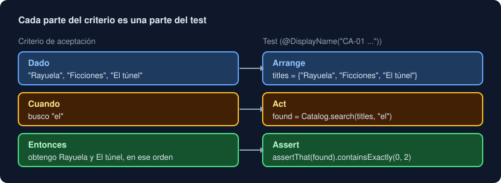

# 03 · Historias de usuario y criterios de aceptación

⏱️ 45 min

## 1. La historia de usuario

Un caso de uso cuenta todos los pasos. Una **historia de usuario** es más corta: una frase que dice quién quiere algo, qué quiere y para qué.

```
Como   bibliotecario
quiero buscar libros por una parte de su título
para   encontrar un libro aunque el socio no recuerde el título exacto.
```

El "para" es lo que más se olvida y lo que más importa: explica el valor. Si no sabes escribirlo, quizá nadie necesita esa función.

Historias y casos de uso no compiten. La historia es la promesa de una conversación; el caso de uso, esa conversación escrita. En tu proyecto escribirás los dos.

## 2. Criterios de aceptación

La historia no dice cuándo está **terminada**. Eso lo dicen sus **criterios de aceptación**: ejemplos concretos, con datos, de cómo debe comportarse el sistema. La forma más usada es **Dado, Cuando, Entonces** (*Given, When, Then*):

```
CA-01  Dado un catálogo con "Rayuela", "Ficciones" y "El túnel"
       cuando busco "el"
       entonces obtengo "Rayuela" y "El túnel", en ese orden.

CA-02  Dado el mismo catálogo
       cuando busco "  FICC "
       entonces obtengo "Ficciones": se ignoran los espacios y las mayúsculas.

CA-03  Dado el mismo catálogo
       cuando busco "Borges"
       entonces no obtengo ningún libro.

CA-04  Dado cualquier catálogo
       cuando busco un texto en blanco
       entonces el sistema rechaza la búsqueda con el mensaje "Búsqueda vacía".
```

| Parte | Qué contiene | Lo que será en el test |
|---|---|---|
| **Dado** | El estado de partida, con datos | *Arrange*: preparar |
| **Cuando** | La acción del actor | *Act*: actuar |
| **Entonces** | El resultado observable | *Assert*: comprobar |

Son las tres partes de un test de la semana 03 con otro nombre. Un buen criterio se puede copiar en un test casi palabra por palabra.

## 3. Del criterio al test



```java
@Test
@DisplayName("CA-01 buscar 'el' encuentra Rayuela y El túnel")
void searchFindsEveryTitleContainingTheText() {
    String[] titles = {"Rayuela", "Ficciones", "El túnel"};    // Dado

    int[] found = Catalog.search(titles, "el");                 // Cuando

    assertThat(found).containsExactly(0, 2);                    // Entonces
}
```

`@DisplayName` (de `org.junit.jupiter.api`) le da al test un nombre legible, con espacios y acentos, que aparece en el informe y en el panel *Testing* de tu editor. Empieza por el identificador del criterio: así, si `CA-01` falla, sabes qué promesa al cliente se ha roto. El nombre del método sigue siendo el que usa `-Dtest`.

## 4. Cuántos criterios

Uno por comportamiento distinto, no uno por dato. Usa lo que ya sabes:

- El **flujo principal** da el primer criterio (CA-01).
- Cada **flujo alternativo** del caso de uso da al menos uno (CA-03: no se encuentra nada; CA-04: entrada rechazada).
- Cada **clase de equivalencia** o **valor límite** que el cliente considere importante da otro (CA-02: mayúsculas y espacios).

Si dos criterios se distinguen solo por los datos, son filas de un mismo `@ParameterizedTest`, no dos criterios.

## 5. Los tests como contrato

Desde la semana 01 el proyecto arranca con tests que no has escrito tú. Ahora sabes de dónde salen: alguien leyó los requisitos, escribió los criterios de aceptación y los convirtió en tests **antes** de programar. Cuando todos pasan, la historia está terminada; si un criterio no tiene test, nadie puede asegurar que se cumple.

## ✅ Comprueba que lo entendiste

1. Escribe la historia de usuario de "Dar de alta un libro", con su "para".
2. Escribe un criterio Dado-Cuando-Entonces para el flujo 2a de CU-01 (no existe el código).
3. ¿Qué parte de `CA-02` sería el *Arrange* del test y cuál el *Assert*?

---

## 🔗 Navegación

| Anterior | Actual | Siguiente |
| -------- | ------ | --------- |
| [02 · Casos de uso](02-casos-de-uso.md) | **03 · Historias y criterios de aceptación** | [04 · Sustantivos y verbos](04-sustantivos-y-verbos.md) |
