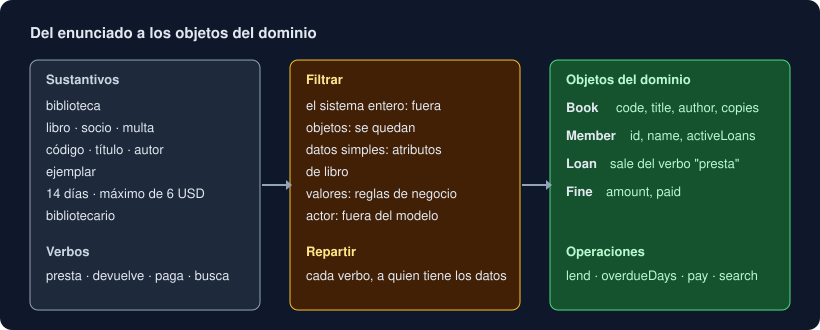

# 04 · Sustantivos y verbos: los objetos del dominio

⏱️ 45 min

## 1. El dominio

El **dominio** es la parte del mundo de la que trata tu sistema: la biblioteca, con sus libros, socios, préstamos y multas. Los **objetos del dominio** son las cosas de ese mundo que el sistema necesita recordar y sobre las que actúa. En la semana 05 cada uno será una **clase** de Java; esta semana los encuentras.

No se inventan: están en el enunciado y en los casos de uso. El método más sencillo para sacarlos es gramatical.

## 2. Subrayar

Vuelve a leer el enunciado de la Biblioteca y subraya:

- Los **sustantivos**: candidatos a objetos del dominio o a sus datos.
- Los **verbos**: candidatos a lo que esos objetos hacen o lo que se hace con ellos.

> La **biblioteca** del barrio *presta* **libros** a sus **socios**. Cada libro *tiene* un **código**, un **título**, un **autor** y varios **ejemplares**. Un socio *puede llevarse* hasta tres libros durante 14 **días**. Si *devuelve* tarde, *paga* una **multa** de 0.30 USD por día, con un **máximo** de 6 USD, y no *puede llevarse* más libros hasta *pagarla*. El **bibliotecario** *da de alta* los libros nuevos y *busca* libros por el título.

## 3. Filtrar los sustantivos

La lista sale larga. Pasa cada sustantivo por estas preguntas, en orden:

| Pregunta | Si la respuesta es sí | Ejemplo |
|---|---|---|
| ¿Es un **sinónimo** de otro? | Quédate con un nombre | "ejemplar" y "copia" |
| ¿Es el **sistema** entero? | Descártalo | "biblioteca" |
| ¿Es un **dato simple** de otro objeto: un número, un texto, una fecha? | Es un **atributo** de ese objeto | "código", "título", "autor" son de **libro** |
| ¿Es un **actor** que solo usa el sistema y del que no hay que recordar nada? | Fuera del modelo | "bibliotecario" |
| ¿Es un **valor de una regla**? | Es una regla de negocio | "14 días", "máximo de 6 USD" |
| ¿Tiene datos propios **y** algo que hacer o que se haga con él? | **Objeto del dominio** | libro, socio, préstamo, multa |

"Préstamo" no aparece como sustantivo en el enunciado, sino como verbo: "presta". Pasa a menudo: un verbo que deja **datos que recordar** (qué libro, qué socio, desde qué día) es también un objeto. Para calcular el retraso hay que saber cuándo empezó el préstamo, así que el préstamo tiene que existir.

El resultado es una tabla:

| Objeto | Atributos | Viene de |
|---|---|---|
| `Book` | `code`, `title`, `author`, `copies` | "Cada libro tiene un código, un título, un autor y varios ejemplares" |
| `Member` | `id`, `name`, `activeLoans` | "socios", "hasta tres libros" |
| `Loan` | `book`, `member`, `startDay`, `dueDay` | "presta", "durante 14 días" |
| `Fine` | `amount`, `paid` | "paga una multa", "hasta pagarla" |

Los nombres van en inglés, como en el código, y son del dominio: `Book`, no `Item` ni `Data`.

## 4. Repartir los verbos

Cada verbo que queda se convierte en una **operación**, y la pregunta es de quién: ¿qué objeto tiene los datos para hacerla?

| Verbo | Operación | Dónde vive | Por qué ahí |
|---|---|---|---|
| busca por el título | `search(query)` | El catálogo: el conjunto de todos los libros | Ningún libro ve a los demás; esta semana es la clase `Catalog` del proyecto, y en la semana 13, una colección |
| presta | `lend(book, member)` | `Loan` se crea; `Book` pierde un ejemplar | `Book` sabe cuántos ejemplares le quedan |
| devuelve tarde | `overdueDays(endDay)` | `Loan` | `Loan` sabe cuándo empezó y cuánto dura |
| paga | `pay()` | `Fine` | `Fine` sabe su importe y si está pagada |

## 5. Lo que ya habías visto

En la semana 02 guardaste el inventario en **arrays paralelos**: `codes[i]` tenía `quantities[i]` unidades. Esta semana añadirás `titles[i]`. Tres arrays con la misma `i` son, en realidad, un solo sustantivo con tres atributos: **un libro**. Mantenerlos alineados a mano es frágil (lo comprobarás en el ejercicio 03), y es justo el problema que resuelven las clases de la semana 05.

## 6. El glosario del dominio

Los nombres que eliges se escriben en un **glosario del dominio**: cada término, qué significa para el cliente y su nombre en el código. Evita que "préstamo" signifique una cosa en un requisito y otra en un test.

| Término | Significado | En el código |
|---|---|---|
| Libro | Obra del catálogo, con uno o más ejemplares | `Book` |
| Ejemplar | Copia física de un libro que se puede prestar | `copies` en `Book` |
| Préstamo | Un ejemplar en manos de un socio, desde un día y con una fecha de devolución | `Loan` |

## ✅ Comprueba que lo entendiste

1. En "El servicio alquila bicicletas a sus usuarios; cada bicicleta tiene un número y una estación; un usuario paga cada alquiler por minutos", ¿qué sustantivos son objetos y cuáles atributos?
2. ¿Por qué "bibliotecario" no está en la tabla de objetos? ¿En qué caso sí lo estaría?
3. ¿Qué tres arrays de tu proyecto son, en realidad, un solo objeto?

---

## 🔗 Navegación

| Anterior | Actual | Siguiente |
| -------- | ------ | --------- |
| [03 · Historias y criterios de aceptación](03-historias-y-criterios-de-aceptacion.md) | **04 · Sustantivos y verbos** | [05 · Tarjetas CRC](05-tarjetas-crc.md) |
