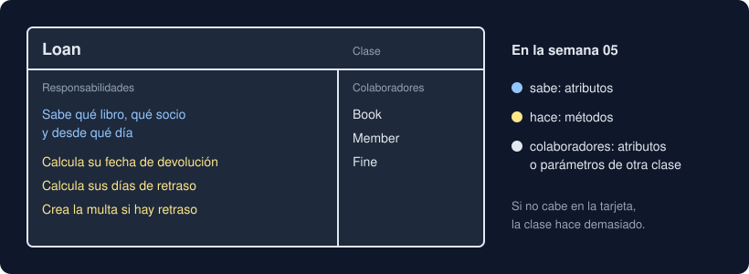

# 05 · Tarjetas CRC: responsabilidades y colaboradores

⏱️ 1 h

## 1. Qué es una tarjeta CRC

Una tabla de objetos y atributos dice qué **datos** guarda cada objeto. Falta lo más importante en POO: qué **sabe** y qué **hace** cada uno, y con quién necesita hablar para hacerlo. Las **tarjetas CRC** (Clase, Responsabilidades, Colaboradores) lo apuntan en una ficha por objeto, del tamaño de una tarjeta de cartulina:



| Parte | Qué escribes | Ejemplo para `Loan` |
|---|---|---|
| **Clase** | El nombre, en inglés y del dominio | `Loan` |
| **Responsabilidades** | Lo que sabe (sus datos) y lo que hace (sus operaciones), con verbos | Sabe qué libro, qué socio y desde qué día. Calcula su fecha de devolución y sus días de retraso |
| **Colaboradores** | Las otras clases a las que necesita pedir algo | `Book`, `Member`, `Fine` |

En una tarjeta física no cabe mucho, y es a propósito: si las responsabilidades no caben, la clase hace demasiado y hay que partirla.

## 2. Las cuatro tarjetas de la Biblioteca

```
┌──────────────────────────────────────────┬───────────────┐
│ Book                                     │               │
├──────────────────────────────────────────┼───────────────┤
│ Sabe su código, título, autor y          │               │
│ cuántos ejemplares le quedan             │               │
│ Presta un ejemplar (si le queda)         │               │
│ Recibe un ejemplar devuelto              │               │
└──────────────────────────────────────────┴───────────────┘

┌──────────────────────────────────────────┬───────────────┐
│ Member                                   │               │
├──────────────────────────────────────────┼───────────────┤
│ Sabe su id, su nombre y cuántos          │ Fine          │
│ préstamos activos tiene                  │               │
│ Dice si puede llevarse otro libro        │               │
└──────────────────────────────────────────┴───────────────┘

┌──────────────────────────────────────────┬───────────────┐
│ Loan                                     │               │
├──────────────────────────────────────────┼───────────────┤
│ Sabe qué libro, qué socio y desde qué    │ Book          │
│ día                                      │ Member        │
│ Calcula su fecha de devolución           │ Fine          │
│ Calcula sus días de retraso al devolver  │               │
│ Crea la multa si hay retraso             │               │
└──────────────────────────────────────────┴───────────────┘

┌──────────────────────────────────────────┬───────────────┐
│ Fine                                     │               │
├──────────────────────────────────────────┼───────────────┤
│ Sabe su importe y si está pagada         │               │
│ Calcula el importe con tarifa y tope     │               │
│ Se marca como pagada                     │               │
└──────────────────────────────────────────┴───────────────┘
```

Las responsabilidades se escriben con verbos, desde el punto de vista del objeto: "Dice si puede llevarse otro libro", no "comprobar socio". `Book` no tiene colaboradores: no necesita a nadie para contar sus ejemplares.

## 3. Repartir bien: quien tiene los datos, hace el trabajo

La regla para decidir dónde va una responsabilidad es sencilla: **la hace el objeto que tiene los datos para hacerla**. ¿Quién calcula los días de retraso? Hace falta el día de inicio y el plazo: los sabe `Loan`. ¿Quién dice si quedan ejemplares? `Book`, que los cuenta.

Señales de un mal reparto:

| Señal | Problema | Arreglo |
|---|---|---|
| Una tarjeta llena y las demás vacías | Una clase lo hace todo y las otras solo guardan datos | Mueve cada responsabilidad a quien tiene los datos |
| Una tarjeta sin responsabilidades que hagan algo | No es un objeto, es un atributo de otro | Fúndela con su dueño |
| Todos colaboran con todos | Cambiar una clase obliga a tocar las demás | Busca quién tiene los datos y corta las colaboraciones que sobran |
| Un nombre como `Manager`, `Helper` o `Data` | No dice qué es del dominio | Usa un sustantivo del enunciado |

## 4. Recorrer un caso de uso con las tarjetas

Las tarjetas se prueban **en voz alta**: pones las cuatro en la mesa, lees los pasos de un caso de uso y, en cada uno, señalas qué tarjeta lo hace. Si un paso no tiene dueño, falta una responsabilidad; si nadie tiene los datos que necesita, falta un colaborador.

CU-01 Prestar un libro, con las tarjetas:

| Paso | Quién | Responsabilidad que usa |
|---|---|---|
| 1. El bibliotecario indica el socio | `Member` | Dice si puede llevarse otro libro (flujo 1a si no) |
| 2. Indica el código del libro | El catálogo | Encuentra un libro por su código (flujo 2a si no) |
| 3. El sistema comprueba que queda un ejemplar | `Book` | Presta un ejemplar, si le queda (flujo 3a si no) |
| 4. Registra el préstamo a 14 días | `Loan` | Se crea con el libro, el socio y el día; calcula su fecha de devolución |

Al recorrerlo aparece algo que no estaba en las tarjetas: "encuentra un libro por su código" no es de ningún libro, es del conjunto de libros, el catálogo. En tu proyecto es la clase `Catalog` de esta semana; en la semana 13 será una colección.

## 5. De la tarjeta a la clase

En la semana 05, cada tarjeta será una clase. La correspondencia es directa:

| En la tarjeta | En Java (semana 05) |
|---|---|
| Clase | `public class Book { ... }` |
| Sabe... | Atributos: `String code; String title; int copies;` |
| Hace... | Métodos: `boolean lend()`, `void giveBack()` |
| Colaboradores | Atributos o parámetros de otra clase: `Book book` dentro de `Loan` |

Lo que hoy son métodos `static` que reciben arrays paralelos (`Stock.report(codes, quantities, capacity)`) pasarán a ser métodos de un objeto que ya tiene sus datos (`book.report()`). El análisis de esta semana es lo que te dirá qué clases escribir.

## ✅ Comprueba que lo entendiste

1. ¿Quién debe calcular el importe de una multa: `Loan`, `Fine` o `Member`? ¿Por qué?
2. Recorre "CU-02 Devolver un libro" con las cuatro tarjetas: ¿qué tarjeta hace cada paso? ¿Falta alguna responsabilidad?
3. Una compañera propone una clase `LibraryManager` que presta, devuelve, cobra y busca. ¿Qué señal de la tabla del apartado 3 ves y cómo la repartirías?

---

## 🔗 Navegación

| Anterior | Actual | Siguiente |
| -------- | ------ | --------- |
| [04 · Sustantivos y verbos](04-sustantivos-y-verbos.md) | **05 · Tarjetas CRC** | [Ejercicio 01 · Casos de uso](../2-practicas/ejercicio-01-casos-de-uso/README.md) |
