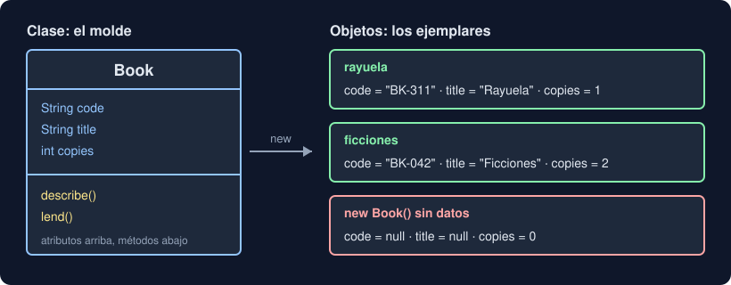

# 01 · De la tarjeta CRC a la clase

⏱️ 50 min

## 1. Lo que ya tienes

En la semana 04 encontraste los objetos de tu dominio y escribiste para cada uno una tarjeta CRC: lo que **sabe** y lo que **hace**. La tarjeta de `Book` decía:

| Book | |
|---|---|
| Sabe su código, su título, su autor y cuántos ejemplares le quedan | |
| Se describe en una línea | |
| Presta un ejemplar si le queda alguno | |

Esta semana esa tarjeta se convierte en código. Lo que sabe serán sus **atributos**; lo que hace, sus **métodos**.

## 2. Una clase es un molde

```java
class Book {
    String code;
    String title;
    int copies;
}
```

Una **clase** es la descripción de un tipo de objeto: qué datos tiene cada uno. No es ningún libro concreto, sino el molde con el que se fabrican. `code`, `title` y `copies` son sus **atributos** (también se llaman campos): variables declaradas dentro de la clase y fuera de cualquier método.

Hasta ahora tus clases (`Fields`, `Stock`, `Rules`) solo eran un sitio donde agrupar métodos `static`. `Book` es distinta: es un **tipo nuevo**, como `String` o `int`, con el que puedes declarar variables.



## 3. Un objeto es un ejemplar del molde

```java
Book rayuela = new Book();
rayuela.code = "BK-311";
rayuela.title = "Rayuela";
rayuela.copies = 1;
```

`new Book()` fabrica un **objeto** (o **instancia**) de la clase `Book`: un libro concreto, con su propio `code`, su propio `title` y sus propios `copies`. Cada `new` fabrica uno nuevo:

```java
Book ficciones = new Book();
ficciones.code = "BK-042";
```

Ahora hay dos objetos. `rayuela.code` y `ficciones.code` se llaman igual, pero son dos cajas distintas. El **punto** dice de qué objeto hablas: `rayuela.copies` es el `copies` de Rayuela.

| | Clase | Objeto |
|---|---|---|
| Qué es | La descripción de un tipo | Un ejemplar concreto de ese tipo |
| Cuántos hay | Una, escrita en el código | Tantos como `new` se ejecuten |
| Ejemplo | `Book` | Rayuela, Ficciones |
| Tiene datos | No: dice qué datos habrá | Sí: los suyos |

## 4. Los valores por defecto

Un objeto recién creado con `new Book()` ya tiene atributos, aunque nadie les haya dado valor:

| Tipo del atributo | Valor por defecto |
|---|---|
| `int`, `long`, `double` | `0`, `0L`, `0.0` |
| `boolean` | `false` |
| `String` y cualquier objeto | `null` |

`null` significa "no apunta a ningún objeto". Un `String` a `null` no es un texto vacío: es la ausencia de texto, y llamar a un método sobre él (`rayuela.title.length()`) lanza `NullPointerException`.

Es una diferencia con las variables locales. Una variable local sin valor no compila (`variable x might not have been initialized`); un atributo siempre tiene valor, el de su tipo por defecto. Que compile no quiere decir que esté bien: un libro con código `null` es un error que Java no ve. El constructor de la [teoría 03](03-constructores.md) lo evita.

## 5. El estado de un objeto

Los valores que tienen los atributos de un objeto en un momento dado son su **estado**. El estado de Rayuela ahora es `"BK-311"`, `"Rayuela"`, `1`. Si se presta su ejemplar, su estado pasa a `"BK-311"`, `"Rayuela"`, `0`: sigue siendo el mismo libro, con otro estado.

Los arrays paralelos de semanas anteriores eran el estado de varios objetos guardado al revés: un array por atributo, en lugar de un objeto por libro.

## 6. Dónde se escribe una clase

En tu proyecto Maven, cada clase pública va en su archivo, y el archivo se llama como la clase: `Book` en `Book.java`, dentro de `src/main/java/gestion/`. La primera línea dice el paquete, `package gestion;`, igual que en `Stock.java`.

En los ejercicios guiados, con un solo `Main.java` y `void main()`, puedes declarar varias clases en el mismo archivo, encima de `main`. Java las mete dentro de una clase `Main` invisible y por eso los errores las llaman `Main.Book`.

## 7. Nombres

| Qué | Convención | Ejemplo |
|---|---|---|
| Clase | Sustantivo en singular, mayúscula inicial, en inglés y del dominio | `Book`, `Bicycle`, no `Books` ni `Data` |
| Atributo | `camelCase`, sustantivo | `code`, `pricePerNight` |
| Variable que guarda un objeto | Lo que es en el problema | `rayuela`, `room`, no `b1` ni `obj` |

## ✅ Comprueba que lo entendiste

1. ¿Cuántas clases y cuántos objetos hay después de ejecutar `Book a = new Book(); Book b = new Book();`?
2. ¿Qué imprime `IO.println(new Book().copies)` y por qué compila aunque nadie haya dado valor a `copies`?
3. Escribe la clase de tu objeto principal con los atributos de su tarjeta CRC. ¿Qué tipo tiene cada uno?

---

## 🔗 Navegación

| Anterior | Actual | Siguiente |
| -------- | ------ | --------- |
| [Semana 05](../README.md) | **01 · De la tarjeta a la clase** | [02 · Métodos de instancia](02-metodos-de-instancia.md) |
