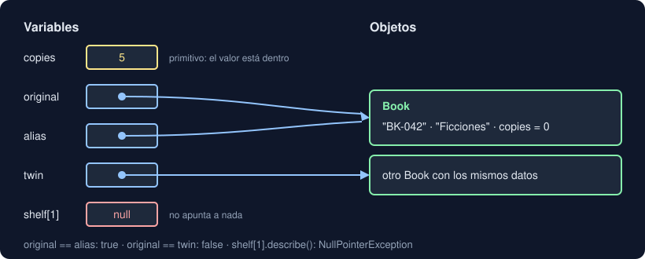

# 04 · Referencias y `null`

⏱️ 50 min

## 1. Qué guarda una variable de tipo `Book`

Una variable `int` guarda un número. Una variable `Book` **no guarda el libro**: guarda una **referencia**, la dirección de dónde está el objeto en memoria. Dibújalo así: la variable es una caja, el objeto es una nube aparte, y la referencia es una flecha de la caja a la nube.



| Tipo | Ejemplos | Qué guarda la variable |
|---|---|---|
| **Primitivo** | `int`, `double`, `boolean`, `char` | El valor |
| **Referencia** | `String`, `Book`, `int[]`, cualquier clase o array | Una flecha a un objeto, o `null` |

Casi todo lo que sorprende en esta teoría sale de esta tabla.

## 2. Asignar copia la flecha

```java
Book original = new Book("BK-042", "Ficciones", 2);
Book alias = original;
alias.copies = 0;
IO.println(original.copies);   // 0
```

`alias = original` no copia el libro: copia la flecha. Hay **un** objeto y dos variables que apuntan a él. Son **alias**: cambiar el objeto por una de ellas se ve por la otra.

Con primitivos es al revés:

```java
int a = 2;
int b = a;
b = 0;
IO.println(a);   // 2: b tenía su propia copia del número
```

## 3. `==` compara flechas

```java
Book twin = new Book("BK-042", "Ficciones", 0);
original == alias   // true: la misma flecha
original == twin    // false: dos objetos, aunque tengan los mismos datos
```

Con objetos, `==` pregunta si dos variables apuntan **al mismo objeto**, no si tienen lo mismo dentro. Por eso los `String` se comparan con `equals` desde la semana 02. Para tus clases escribirás tu propio `equals` en la semana 11; hasta entonces, compara sus atributos.

## 4. Pasar un objeto a un método

Java siempre pasa a los métodos una **copia** de lo que tiene la variable. Con un primitivo, una copia del valor; con un objeto, una copia de la flecha:

```java
void emptyShelf(Book book) {
    book.copies = 0;                         // cambia el objeto: quien llamó lo ve
}

void replace(Book book) {
    book = new Book("BK-999", "Otro", 9);    // cambia la copia de la flecha: quien llamó no lo ve
}

void addOne(int copies) {
    copies++;                                // cambia la copia del número: quien llamó no lo ve
}
```

La regla, en una frase: un método puede cambiar **el objeto** que recibe, pero nunca **a qué objeto apunta** la variable de quien lo llamó.

Es lo que comprueban los tests `addKeepsOriginal` y `removeKeepsOrder` de tu `Catalog`: un array es un objeto, y si `add` lo cambiara por dentro, quien lo llamó vería el cambio. Por eso `Catalog.add` devuelve un array nuevo.

## 5. `null`: una variable sin objeto

Una variable de referencia puede no apuntar a nada: vale `null`. Es el valor por defecto de los atributos de tipo objeto y de las posiciones de un array de objetos:

```java
Book[] shelf = new Book[3];   // tres referencias, todas null: ningún libro
shelf[0] = rayuela;
```

`new Book[3]` crea un array de tres **flechas vacías**, no tres libros. Usar un método o un atributo a través de `null` lanza `NullPointerException`:

```
java.lang.NullPointerException: Cannot invoke "Main$Book.describe()" because "this.shelf[1]" is null
```

Desde Java 15 el mensaje dice **qué** era `null`. Léelo entero antes de buscar el error: te dice la expresión exacta.

Para recorrer un array a medio llenar, comprueba antes:

```java
for (Book book : shelf) {
    if (book != null) {
        IO.println(book.describe());
    }
}
```

`book != null` compara la flecha: es uno de los pocos `==` o `!=` que tiene sentido con objetos.

## 6. Los objetos que nadie apunta

```java
Book b = new Book("BK-500", "Pedro Páramo", 1);
b = new Book("BK-501", "El llano en llamas", 4);
```

Después de la segunda línea, nadie apunta a Pedro Páramo: ese objeto ya no se puede usar. Java lo detecta y libera su memoria él solo, con el **recolector de basura** (*garbage collector*). No hay que borrar objetos a mano.

## ✅ Comprueba que lo entendiste

1. Después de `Book b = a; b.copies--;`, ¿cambia `a.copies`? ¿Y después de `int y = x; y--;`, cambia `x`?
2. ¿Qué devuelve `new Book("BK-1", "A", 1) == new Book("BK-1", "A", 1)`? ¿Por qué?
3. ¿Por qué `replace(rayuela)` no cambia `rayuela` y `emptyShelf(rayuela)` sí?
4. ¿Qué contiene `new Book[3]` justo después de crearlo? ¿Qué pasa si llamas a `describe()` sobre su posición 0?

---

## 🔗 Navegación

| Anterior | Actual | Siguiente |
| -------- | ------ | --------- |
| [03 · Constructores](03-constructores.md) | **04 · Referencias y `null`** | [05 · `static` y arrays de objetos](05-static-y-arrays-de-objetos.md) |
