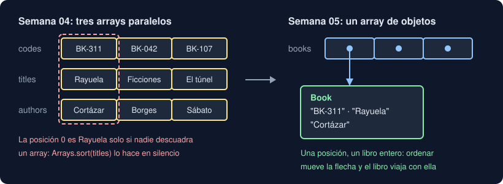

# 05 · `static` y arrays de objetos

⏱️ 45 min

## 1. De la clase o de cada objeto

Ya conoces las dos formas de llamar a un método:

```java
Stock.level(3, 8)      // static: con el nombre de la clase
rayuela.describe()     // de instancia: con un objeto
```

La palabra `static` decide a quién pertenece algo:

| | De instancia (sin `static`) | De clase (`static`) |
|---|---|---|
| Atributo | Cada objeto tiene el suyo | Hay uno solo, compartido por todos |
| Método | Se llama sobre un objeto y usa sus atributos | Se llama con el nombre de la clase; no hay `this` |
| Ejemplo | `title`, `describe()`, `take()` | `Book.created`, `Book.indexOf(books, code)` |

## 2. Un atributo `static`

```java
class Book {
    static int created = 0;

    String code;
    ...

    Book(String code, String title, String author) {
        ...
        created++;
    }
}
```

`created` no es de ningún libro: es de la clase. Hay un solo `created`, y cada constructor lo sube. Se lee con el nombre de la clase:

```java
IO.println(Book.created);   // cuántos libros se han creado
```

Si le quitas `static`, cada libro tendría su propio `created` (que valdría 1), y `Book.created` deja de compilar:

```
error: non-static variable created cannot be referenced from a static context
```

El mensaje dice lo que pasa: desde la clase, sin un objeto, no sabes de qué libro hablas. Los atributos `static` que cambian son raros en código real (casi siempre es mejor que el dato sea de algún objeto); los verás sobre todo como constantes, en la semana 06.

## 3. Cuándo un método es `static`

Haz la pregunta de la tarjeta CRC: ¿quién tiene los datos?

- Si el método necesita los datos de **un** objeto, es de instancia: `describe()`, `matches(query)`, `take()`.
- Si no necesita ningún objeto, o trabaja con **varios** a la vez, es `static`: `Fields.normalizeCode(code)`, `Book.indexOf(books, code)`, `Book.total(books)`.

`indexOf` busca un libro entre muchos. Ningún libro ve a los demás, así que no puede ser de instancia: recibe el array.

```java
static int indexOf(Book[] books, String code) {
    for (int i = 0; i < books.length; i++) {
        if (books[i].code.equals(code)) {
            return i;
        }
    }
    return -1;
}
```

Un método `static` no tiene `this`, así que no puede usar `code` a secas: usa `books[i].code`, el de cada libro. Si lo intentas, el error es el de antes: `non-static variable code cannot be referenced from a static context`.

Las clases de semanas anteriores (`Fields`, `Stock`, `Rules`, `Catalog`) solo tienen métodos `static` porque todavía no había objetos. Desde ahora, la mayoría de los métodos nuevos serán de instancia.

## 4. Un array de objetos

Los tres arrays paralelos de la semana 04 se convierten en uno solo:

```java
// Antes: tres arrays, y la posición i de cada uno habla del mismo libro
String[] codes = {"BK-311", "BK-042", "BK-107"};
String[] titles = {"Rayuela", "Ficciones", "El túnel"};
String[] authors = {"Cortázar", "Borges", "Sábato"};

// Ahora: un array de libros, cada uno con sus datos dentro
Book[] books = {
    new Book("BK-311", "Rayuela", "Cortázar"),
    new Book("BK-042", "Ficciones", "Borges"),
    new Book("BK-107", "El túnel", "Sábato")
};
```



Cada posición de `books` guarda una **referencia** a un libro. Los dos problemas de los arrays paralelos desaparecen:

| Problema en la semana 04 | Con objetos |
|---|---|
| Dar de alta un libro sin autor dejaba `null` en silencio | El constructor pide los tres datos: si falta uno, no compila |
| `Arrays.sort(titles)` movía los títulos y no los códigos | Ordenar mueve referencias: cada libro se mueve entero |
| Crecer el catálogo eran tres `Arrays.copyOf` | Uno solo |

Para intercambiar dos libros basta mover sus referencias:

```java
Book swap = books[i];
books[i] = books[j];
books[j] = swap;
```

Tres líneas, y el código, el título y el autor viajan juntos porque están en el mismo objeto.

## 5. Recorrer un array de objetos

El `for` mejorado sirve igual que con números, y en cada vuelta la variable es un objeto con sus métodos:

```java
for (Book book : books) {
    if (book.matches("el")) {
        IO.println(book.describe());
    }
}
```

Recuerda la [teoría 04](04-referencias-y-null.md): si el array se creó con `new Book[n]` y no se llenó entero, algunas posiciones son `null`.

Los arrays tienen tamaño fijo: dar de alta o de baja sigue obligando a crear uno nuevo. En la semana 13 los cambiarás por listas, que crecen solas.

## ✅ Comprueba que lo entendiste

1. ¿Por qué `describe()` es de instancia y `indexOf(books, code)` es `static`?
2. Si `created` no fuera `static`, ¿cuánto valdría el `created` de cada libro después de crear cuatro?
3. ¿Por qué ordenar un `Book[]` no puede descuadrar los títulos de los autores, y ordenar `titles` sí?

---

## 🔗 Navegación

| Anterior | Actual | Siguiente |
| -------- | ------ | --------- |
| [04 · Referencias y `null`](04-referencias-y-null.md) | **05 · `static` y arrays de objetos** | [Ejercicio 01 · Clases y objetos](../2-practicas/ejercicio-01-clases-y-objetos/README.md) |
