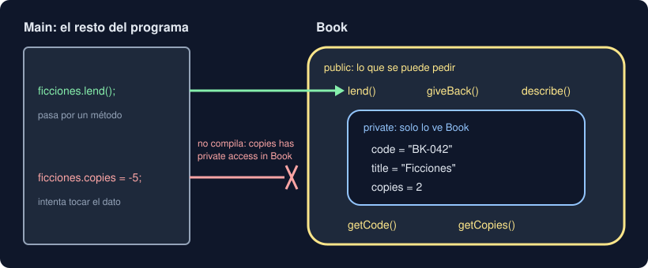

# 01 · Encapsulación y `private`

⏱️ 50 min

## 1. El problema

Tu clase de la semana 05 funciona, pero cualquiera puede hacer esto desde cualquier parte del programa:

```java
Book ficciones = new Book("BK-042", "Ficciones", 2);
ficciones.copies = -5;
ficciones.code = "";
```

Java no se queja: `copies` es un `int` y −5 es un `int`. La regla "los ejemplares no son negativos" estaba en `take()`, que comprueba antes de restar... pero nadie obliga a pasar por `take()`. Una regla que se puede saltar no es una regla, es una sugerencia.

En un programa de diez líneas lo ves enseguida. En uno de diez mil, cuando un libro aparece con −5 ejemplares, el culpable puede ser **cualquier** línea que tenga un `Book` a mano.

## 2. Encapsular

**Encapsular** es juntar en una clase los datos y las reglas que los protegen, y decidir qué puede tocar el resto del programa. La idea tiene dos partes:

1. Los datos se esconden: desde fuera no se pueden leer ni escribir directamente.
2. El objeto ofrece métodos para lo que tiene sentido pedirle (prestar, devolver, describirse), y cada método cumple las reglas.



El resultado: si un libro queda en un estado imposible, el error **solo puede estar dentro de `Book`**. Buscas en una clase, no en todo el programa.

## 3. `private`

Java esconde un atributo con la palabra `private`:

```java
class Book {
    private String code;
    private String title;
    private int copies;
    ...
}
```

`private` significa: **solo el código de esta clase** puede usar este atributo. Desde otra clase, no compila:

```
Main.java:25: error: copies has private access in Book
        ficciones.copies = -5;
                 ^
```

Es un error de compilación: sale antes de ejecutar, en la línea exacta, y nunca llega a existir un libro con −5. Lo verás en el ejercicio 01.

Dentro de la clase, `private` no cambia nada. Los métodos de `Book` siguen usando `copies` como siempre, y también pueden tocar los atributos `private` de **otro** `Book`: la frontera es la clase, no el objeto. Por eso tu `indexOf(items, code)` `static` puede seguir leyendo `items[i].code`.

## 4. Los cuatro niveles de acceso

`private` es uno de cuatro niveles. De más cerrado a más abierto:

| Modificador | Quién puede usarlo | Para qué |
|---|---|---|
| `private` | Solo la propia clase | Atributos, casi siempre, y métodos auxiliares internos |
| (ninguno) | Las clases del mismo paquete | Lo que usaste hasta la semana 05. Se llama acceso de paquete |
| `protected` | El paquete y las subclases | Lo verás con la herencia, en la semana 07 |
| `public` | Cualquier clase | Lo que la clase ofrece al resto: constructores y métodos |

La regla práctica: **atributos `private` siempre**; métodos `public` solo los que el resto del programa necesita; el resto, `private`. Abrir algo después es fácil; cerrarlo, cuando ya hay código que lo usa, obliga a cambiar ese código.

Todas tus clases del proyecto están en el paquete `gestion`. Por eso hasta ahora no notaste la diferencia entre "sin modificador" y `public`: en la semana 12 repartirás tus clases en varios paquetes y la notarás.

## 5. Una trampa de los archivos de un solo `Main.java`

En la semana 05, los ejercicios tenían las clases escritas sin más dentro del archivo, encima de `void main()`. En un archivo así, Java mete **todo** dentro de una clase `Main` invisible, y `Book` queda dentro de ella. Como `private` es "solo dentro de la clase", y `main` y `Book` están dentro de la misma `Main`, `main` puede tocar los atributos `private` de `Book` sin error.

Por eso los ejercicios de esta semana empiezan con `class Main { ... }` y ponen las demás clases **después y fuera** de ella. En tu proyecto Maven no pasa: cada clase está en su archivo.

## 6. Lo que se esconde se puede cambiar

Encapsular tiene una segunda ventaja, menos obvia. Si nadie de fuera usa `copies`, mañana puedes cambiar cómo guardas los datos sin romper a nadie. Por ejemplo, guardar el total de ejemplares y los prestados:

```java
class Book {
    private int copies;   // total
    private int lent;     // prestados

    String describe() {
        return code + " · " + title + " · en estantería: " + (copies - lent) + " de " + copies;
    }
}
```

Quien usaba `describe()` y `lend()` no nota nada. Quien usaba `book.copies` directamente, sí. Lo que una clase deja ver es un **contrato** con el resto del programa; lo que esconde, un detalle que puede cambiar.

## ✅ Comprueba que lo entendiste

1. ¿Qué problema tiene una regla que solo está en `take()` si `copies` no es `private`?
2. ¿Puede un método de `Book` leer el `copies` `private` de **otro** objeto `Book`? ¿Por qué?
3. ¿Por qué un ejercicio en un solo archivo, con `Book` dentro de la `Main` invisible, no da error al hacer `book.copies = -5` aunque `copies` sea `private`?

---

## 🔗 Navegación

| Anterior | Actual | Siguiente |
| -------- | ------ | --------- |
| [Semana 06](../README.md) | **01 · Encapsulación y `private`** | [02 · *Getters*, *setters* y comportamiento](02-getters-setters-y-comportamiento.md) |
