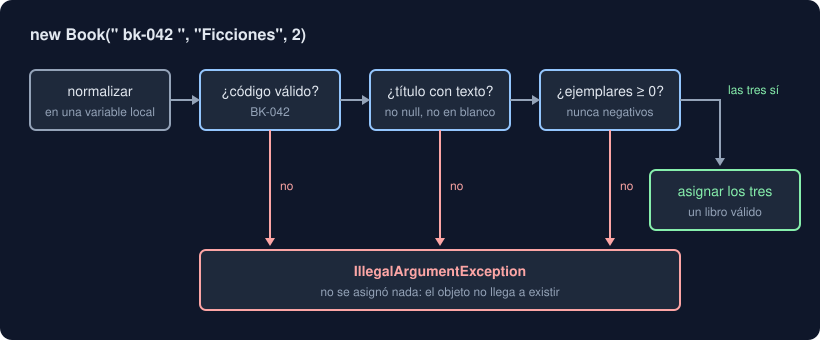

# 03 · Constructores que validan

⏱️ 50 min

## 1. La puerta de entrada

Con atributos `private` y órdenes que comprueban, un libro **válido** sigue siendo válido. Pero ¿y si nace mal?

```java
Book broken = new Book("???", "   ", -5);
```

El constructor de la semana 05 lo acepta: normaliza `"???"` (que sigue siendo `"???"`), quita los espacios del título (que queda vacío) y guarda −5. El libro existe, en mal estado, desde el primer instante. Todas las comprobaciones de `take()` y `restock()` no sirven de nada si la puerta de entrada está abierta.

## 2. Rechazar en el constructor

Un constructor puede lanzar una excepción, como cualquier método:

```java
public Book(String code, String title, int copies) {
    String normalized = Fields.normalizeCode(code);
    if (!Stock.isValidCode(normalized)) {
        throw new IllegalArgumentException("Código no válido: " + normalized);
    }
    if (title == null || title.isBlank()) {
        throw new IllegalArgumentException("Título vacío");
    }
    if (copies < 0) {
        throw new IllegalArgumentException("Ejemplares no válidos: " + copies);
    }
    this.code = normalized;
    this.title = title.strip();
    this.copies = copies;
}
```

Si lanza la excepción, `new` **no devuelve ningún objeto**: la variable que iba a recibirlo nunca lo recibe. No hay un libro "a medias" que limpiar. Es la idea de ***fail fast***: fallar en cuanto aparece el dato malo, en la línea que lo trajo, y no tres clases después, cuando alguien intenta prestar un libro con −5 ejemplares.



Fíjate en tres detalles:

- **Reutiliza** las reglas que ya tienes: `Fields.normalizeCode` (semana 01) y `Stock.isValidCode` (semana 02). Una regla, un sitio.
- Lanza `IllegalArgumentException`, no `IllegalStateException`: el problema está en un **argumento** que se pasó a `new`. `IllegalStateException` es para cuando un objeto que ya existe no puede hacer algo por cómo está (`take()` sin unidades).
- El mensaje dice qué falló y con qué valor: `"Código no válido: BK042"`. Quien lo lea en un test o en la consola sabe qué corregir.

## 3. Comprobar todo, después asignar

El orden importa. Compara:

```java
// Mal: asigna y luego comprueba
this.code = normalized;
this.title = title.strip();
if (copies < 0) {
    throw new IllegalArgumentException(...);
}
```

En un constructor, si lanza la excepción el objeto se pierde de todas formas. Pero en un **método** que cambia varios atributos, asignar antes de comprobar deja el objeto con una mezcla de datos nuevos y viejos. Lo verás con `HalfBook.change` en el paso 3 del ejercicio 02. La costumbre sana, en constructores y en órdenes, es la misma: **primero todas las comprobaciones, después todas las asignaciones**.

Por eso el código normalizado se guarda en una variable local, `normalized`: se comprueba con ella y se asigna con ella, sin normalizar dos veces.

## 4. Sobrecarga: más de un constructor

En una biblioteca, a veces se da de alta un título antes de que lleguen los ejemplares. Sería cómodo crear un libro sin decir `0`:

```java
Book aleph = new Book("BK-777", "El Aleph");
```

Una clase puede tener **varios constructores**, siempre que sus listas de parámetros sean distintas (en número o en tipos). Es la **sobrecarga**, la misma que ya conoces de los métodos: `println(int)` y `println(String)` son dos métodos distintos con el mismo nombre.

```java
public Book(String code, String title) {
    this(code, title, 0);
}
```

`this(...)` llama a **otro constructor de la misma clase**. Este constructor no repite ninguna comprobación: delega en el de tres parámetros, que valida y asigna. Si mañana añades una regla, la escribes una vez y vale para los dos.

No confundas:

| Escribes | Significa |
|---|---|
| `this.code` | El atributo `code` de este objeto |
| `this(code, title, 0)` | Llamar al constructor de esta clase que recibe esos parámetros |

Lo habitual es que `this(...)` sea la primera línea del constructor. Desde Java 25 puede llevar líneas antes, siempre que no usen el objeto que se está creando (JEP 513), pero esta semana no lo necesitas.

## 5. ¿Cuántos constructores?

Los que tu dominio necesite, y no más. Cada uno es otra forma de crear el objeto que hay que probar y mantener. Uno con todos los datos es casi siempre obligatorio; otro más corto, si hay un caso real de tu dominio que lo pida (el alta sin existencias). Cuando una clase empieza a necesitar cuatro o cinco constructores, hay mejores herramientas, como el patrón *Builder* (semana 19).

## ✅ Comprueba que lo entendiste

1. ¿Qué devuelve `new Book("???", "Ficciones", 2)` si el constructor lanza una excepción? ¿Qué valor tiene la variable que iba a recibirlo?
2. ¿Por qué el constructor lanza `IllegalArgumentException` y `take()` lanza `IllegalStateException`?
3. ¿Qué pasa con la validación si el constructor de dos parámetros, en lugar de `this(code, title, 0)`, asigna los atributos él mismo?

---

## 🔗 Navegación

| Anterior | Actual | Siguiente |
| -------- | ------ | --------- |
| [02 · *Getters*, *setters* y comportamiento](02-getters-setters-y-comportamiento.md) | **03 · Constructores que validan** | [04 · `final` e inmutabilidad](04-final-e-inmutabilidad.md) |
