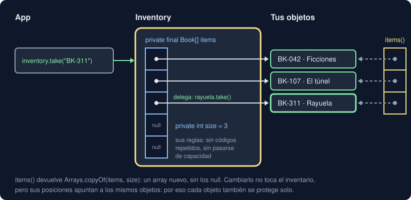

# 05 · Composición y delegación

⏱️ 50 min

## 1. Reglas que un objeto solo no puede cumplir

Tu entidad ya se protege: no nace con datos malos y no deja que sus unidades bajen de cero. Pero hay reglas que ningún libro puede cumplir por su cuenta:

- "No hay dos libros con el mismo código en el catálogo." Un libro no ve a los demás.
- "En la estantería caben 50 libros." Un libro no sabe dónde está.

En la semana 05 esas reglas vivían en métodos `static` que recibían un array (`Book.indexOf(items, code)`), y el array lo manejaba `main`, que podía añadir lo que quisiera. Esas reglas necesitan un **dueño**: un objeto que guarde los libros y sea el único que los toca.

## 2. Composición: un objeto que tiene otros

```java
public class Inventory {
    private final Book[] items;
    private int size;

    public Inventory(int capacity) {
        this.items = new Book[capacity];
    }
    ...
}
```

Un `Inventory` **tiene** libros. Eso es una **composición**: un objeto construido con otros objetos dentro, en sus atributos. Es la relación más común en la orientación a objetos, y ya la usabas sin nombrarla: un `Book` tiene un `String code`.

La pregunta para reconocerla es "¿tiene un...?": un inventario tiene libros, un préstamo tiene un libro y un socio, un pedido tiene líneas. En la semana 07 verás la otra relación, la herencia, que responde a "¿es un...?". Cuando dudes entre las dos, la composición casi siempre es la buena.



El array `items` tiene una capacidad fija y se llena de izquierda a derecha: las posiciones de `0` a `size - 1` tienen libros; el resto, `null`. `size` dice cuántos hay, no cuántos caben. Es la forma de manejar "una lista que crece" con un array; en la semana 13 la cambiarás por `List`, que lo hace sola.

## 3. El dueño pone las reglas

Como `items` es `private`, la única forma de meter un libro es `add`, y `add` comprueba **antes** de cambiar nada:

```java
public void add(Book item) {
    if (contains(item.getCode())) {
        throw new IllegalArgumentException("Código repetido: " + item.getCode());
    }
    if (size == items.length) {
        throw new IllegalStateException("Inventario lleno: " + items.length);
    }
    items[size] = item;
    size++;
}
```

Las dos excepciones son distintas a propósito: un código repetido es un **argumento** que no vale; un inventario lleno es un **estado** en el que no se puede añadir nada, sea cual sea el libro.

## 4. Delegación

```java
public void take(String code) {
    find(code).take();
}
```

El inventario no resta unidades: busca el libro y le pasa la orden. Eso es **delegar**. Cada objeto hace lo que le corresponde:

| Objeto | Sus reglas |
|---|---|
| `Book` | Sus unidades no bajan de 0; su código no cambia |
| `Inventory` | Sin códigos repetidos; no se pasa de su capacidad |

Si el inventario restara él mismo (`items[i].quantity--`, si pudiera), la regla "no bajar de 0" tendría que estar en dos sitios. Con delegación, `inventory.take("BK-311")` sin unidades lanza **la misma excepción** que `book.take()`, con el mismo mensaje, porque es el libro quien la lanza.

## 5. El array que se escapa

Hay una forma sutil de romper todo esto:

```java
public Book[] items() {
    return items;   // ¡devuelve el array de verdad!
}
```

`items` es `private`, pero este método reparte **la referencia** al array. Quien la recibe tiene un alias del array del inventario (semana 05) y puede hacer `copia[0] = null` o meter un libro con código repetido, sin pasar por `add`. El paso 4 del ejercicio 03 lo hace, y `total()` revienta con `NullPointerException`.

La solución es una **copia defensiva**: devolver un array nuevo con los mismos elementos.

```java
public Book[] items() {
    return Arrays.copyOf(items, size);
}
```

`Arrays.copyOf(array, n)` crea un array de longitud `n` con los primeros `n` elementos. Con `size`, la copia lleva solo las posiciones ocupadas, sin `null`. Quien la cambie, cambia su copia.

Ojo: `Arrays.copyOf` copia las **referencias**, no los libros. La copia y el inventario apuntan a los mismos objetos, y `copia[0].take()` sí cambia un libro del inventario. Aquí no es un problema, porque cada libro se protege solo: la copia defensiva protege lo que el inventario controla (qué libros hay y en qué orden), y cada libro protege lo suyo.

## 6. Composición en tu proyecto

En el proyecto escribes `Inventory` para tu entidad. Fíjate en lo que reutiliza:

- `contains` y `find` usan tu `indexOf(items, code)` de la semana 05 sobre `items()`, que no tiene posiciones `null`.
- `total()` llama a tu `total(items)` `static`.
- `take(code)` delega en tu `take()`.

No hay ninguna regla nueva escrita dos veces. Es la señal de que cada responsabilidad está en su sitio, como pedían tus tarjetas CRC de la semana 04: cada clase sabe lo suyo y colabora con las demás.

## ✅ Comprueba que lo entendiste

1. ¿Por qué "no hay dos libros con el mismo código" no puede ser una regla de `Book`?
2. ¿Qué diferencia hay entre `return items;` y `return Arrays.copyOf(items, size);`? ¿Qué puede hacer quien recibe cada uno?
3. Con la copia defensiva, ¿puede alguien de fuera dejar un libro del inventario con −1 unidades? ¿Por qué no?

---

## 🔗 Navegación

| Anterior | Actual | Siguiente |
| -------- | ------ | --------- |
| [04 · `final` e inmutabilidad](04-final-e-inmutabilidad.md) | **05 · Composición y delegación** | [Ejercicio 01 · Encapsular una clase](../2-practicas/ejercicio-01-encapsular-una-clase/README.md) |
