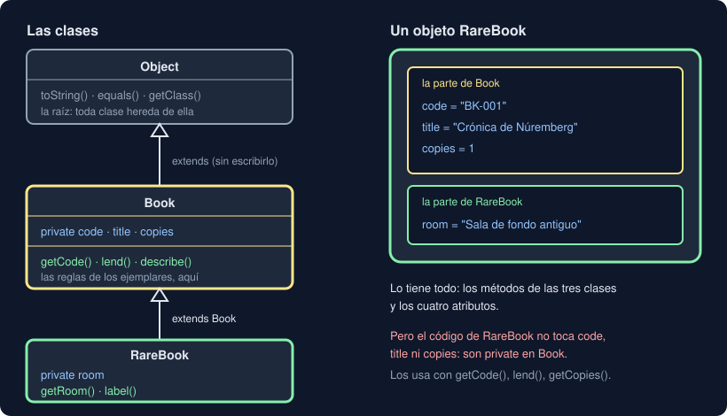

# 01 · Herencia y `extends`

⏱️ 50 min

## 1. Una clase que se parece mucho a otra

La Biblioteca tiene libros raros: incunables, manuscritos, primeras ediciones. Un libro raro tiene código, título y ejemplares, se presta (o no) y se describe, como cualquier libro. Y además se guarda en una sala concreta.

Con lo que sabes hasta ahora tienes dos opciones, y las dos son malas:

- Añadir `room` a `Book`. Todos los libros tendrían sala, aunque solo la usen unos pocos, y cada libro normal llevaría un `null`.
- Copiar `Book` entero en una clase `RareBook` y añadirle la sala. Cada regla (el código válido, no bajar de 0 ejemplares) estaría escrita dos veces, y un arreglo en una se olvidaría en la otra.

La herencia es la tercera opción.

## 2. `extends`

```java
class RareBook extends Book {
    private final String room;

    RareBook(String code, String title, int copies, String room) {
        super(code, title, copies);
        this.room = room;
    }

    String getRoom() {
        return room;
    }
}
```

`RareBook extends Book` dice: un `RareBook` es un `Book` con algo más. `RareBook` es la **subclase** (o clase hija) y `Book`, la **superclase** (o clase padre). La subclase **hereda** lo que tiene el padre:

- Sus **atributos**: cada `RareBook` lleva dentro un código, un título y unos ejemplares, aunque `RareBook` no los declare.
- Sus **métodos**: `chronicle.describe()`, `chronicle.lend()` y `chronicle.getCode()` funcionan sin escribirlos otra vez.

Y **añade** lo suyo: `room` y `getRoom()`. Un `Book` normal no tiene sala.



## 3. Lo que se hereda y lo que se puede tocar

Hay una diferencia importante entre **tener** un atributo y **poder tocarlo**. Un `RareBook` tiene `copies`, pero si `RareBook` escribe `copies = 1;`, no compila:

```
Main.java:131: error: copies has private access in Book
        copies = 1;
        ^
```

`private` es "solo dentro de `Book`", y `RareBook` es otra clase, aunque herede de ella. Para cambiar los ejemplares, la subclase usa lo mismo que el resto del programa: `lend()`, `restock(n)`, `getCopies()`. Es una buena noticia: las reglas que protegían a `Book` en la semana 06 también protegen a `Book` de sus subclases. Lo verás en el paso 6 del ejercicio 01.

| Miembro de `Book` | ¿Lo tiene un `RareBook`? | ¿Lo puede usar el código de `RareBook`? |
|---|---|---|
| Atributo `private` | Sí | No: solo con los métodos de `Book` |
| Método `public` o sin modificador | Sí | Sí, como si fuera suyo |
| Constructor | No se hereda | Lo llama con `super(...)` (teoría 02) |

## 4. Un `RareBook` es un `Book`

Como un `RareBook` es un `Book`, cabe en una variable de tipo `Book`, y en un array de `Book`:

```java
Book asBook = chronicle;              // compila
Book[] shelf = { ficciones, chronicle };
chronicle instanceof Book             // true
```

Lo contrario no vale: un `Book` cualquiera no es un `RareBook`, porque no tiene sala.

La variable decide qué puedes **pedir**. A través de `asBook`, el compilador solo ve los métodos de `Book`, así que `asBook.getRoom()` no compila (`cannot find symbol`), aunque el objeto sea un `RareBook` con su sala. Esto parece una limitación, pero es la base de la semana 08: un método que recibe un `Book` sirve para cualquier subclase de `Book`, presente o futura. En tu proyecto, `Inventory` guarda objetos de tu clase... y por eso, sin cambiar una línea, también guarda los de tu subclase.

## 5. Una sola clase padre, y arriba del todo `Object`

En Java, una clase hereda de **una sola** clase: `class A extends B, C` no compila. (En la semana 09 verás las interfaces, que resuelven lo que se haría con varias.)

¿Y `Book`, que no escribe `extends`? Hereda de **`Object`**. Toda clase que no dice `extends` hereda de `java.lang.Object`, así que todas las clases de Java forman un único árbol con `Object` en la raíz. Por eso cualquier objeto tiene métodos que nunca escribiste, como `toString()`, `equals()` y `getClass()`. `toString()` lo sobrescribirás esta semana (teoría 03); `equals()`, en la semana 11.

## 6. El vocabulario

| Dices | Significa |
|---|---|
| `RareBook` **hereda de** (o **extiende**) `Book` | `class RareBook extends Book` |
| `Book` es la **superclase** de `RareBook` | Su clase padre, la de arriba en el árbol |
| `RareBook` es una **subclase** de `Book` | Su clase hija |
| **Jerarquía** | El árbol de clases: `Object` → `Book` → `RareBook` |
| **Relación "es un"** | Lo que expresa la herencia: un libro raro *es un* libro |

## ✅ Comprueba que lo entendiste

1. `RareBook` no declara `code`. ¿Tiene código un `RareBook`? ¿Puede `RareBook` leer `code` directamente? ¿Cómo lo lee?
2. ¿Compila `Book b = new RareBook(...)`? ¿Y `RareBook r = new Book(...)`? ¿Por qué?
3. ¿De qué clase hereda una clase que no escribe `extends`? Nombra un método que tiene cualquier objeto sin que lo escribas.

---

## 🔗 Navegación

| Anterior | Actual | Siguiente |
| -------- | ------ | --------- |
| [Semana 07](../README.md) | **01 · Herencia y `extends`** | [02 · Constructores y `super`](02-constructores-y-super.md) |
