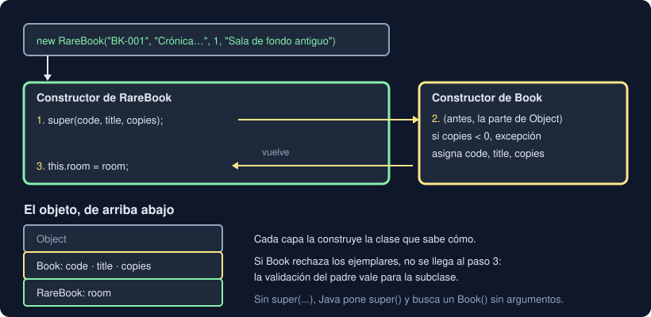

# 02 · Constructores y `super`

⏱️ 45 min

## 1. Los constructores no se heredan

Un `RareBook` hereda los métodos de `Book`, pero no sus constructores. Tiene sentido: el constructor de `Book` sabe crear un libro con código, título y ejemplares, pero no sabe nada de salas. Cada subclase escribe los suyos.

Lo que sí hace el constructor de la subclase es **pedirle al padre** que construya su parte:

```java
RareBook(String code, String title, int copies, String room) {
    super(code, title, copies);
    this.room = room;
}
```

`super(code, title, copies)` llama al constructor de `Book` con esos argumentos. Ese constructor comprueba los ejemplares y asigna `code`, `title` y `copies`, los atributos `private` que `RareBook` no podría asignar. Después, `RareBook` asigna lo suyo.

## 2. Se construye de arriba abajo

Un `RareBook` es un `Book` con algo más, así que primero se construye el `Book` y después lo que añade:



1. `new RareBook(...)` entra en el constructor de `RareBook`.
2. `super(...)` construye la parte de `Book` (que, a su vez, empieza por la de `Object`).
3. Vuelve a `RareBook`, que asigna `room`.

Cuando `new` termina, el objeto está entero, y cada capa la construyó la clase que sabe cómo.

Lo mejor de esto: la **validación del padre vale para la subclase**. Si `Book` rechaza `-1` ejemplares, `new RareBook("BK-002", "Códice", -1, "Sala 2")` también lanza la excepción, sin que `RareBook` escriba esa regla. En tu proyecto, tu subclase llamará a tu constructor de la semana 06, y heredará gratis las tres comprobaciones.

## 3. El `super()` que pone Java

Si un constructor no llama a `super(...)` ni a `this(...)`, Java pone por su cuenta `super()`, **sin argumentos**. Con `Book`, que no tiene constructor sin argumentos, eso no compila:

```
Main.java:117: error: constructor Book in class Book cannot be applied to given types;
    RareBook(String code, String title) {
                                        ^
  required: String,String,int
  found:    no arguments
```

El mensaje dice "constructor Book" aunque el error esté en `RareBook`: es el `super()` invisible el que no encuentra un constructor de `Book` sin argumentos. La solución es llamar tú a `super(...)` con los datos que pide, o a otro constructor de `RareBook` con `this(...)`, que a su vez llamará a `super(...)`. Es el paso 7 del ejercicio 01.

## 4. Comprobar antes de `super(...)` (Java 25)

Una subclase puede tener sus propias reglas. En el proyecto, tu subclase guarda una **reserva** que no puede ser negativa. ¿Dónde se comprueba?

```java
ReservedBook(String code, String name, int quantity, int reserve) {
    if (reserve < 0) {
        throw new IllegalArgumentException("Reserva no válida: " + reserve);
    }
    super(code, name, quantity);
    this.reserve = reserve;
}
```

Hasta Java 24, `super(...)` tenía que ser la primera línea, y la comprobación iba después: se construía la parte de `Book` para tirarla a la basura un instante después. Desde Java 25 (JEP 513, *Flexible Constructor Bodies*), un constructor puede llevar líneas **antes** de `super(...)`, siempre que no lean el objeto que se está creando: ni sus atributos ni sus métodos (`getCode()`, por ejemplo). Sí pueden dar valor a un atributo de la propia subclase, pero esta semana no lo necesitas. Comprobar un argumento no usa el objeto, así que se puede hacer ahí: es *fail fast* en estado puro.

## 5. `super(...)` y `super.metodo()`

`super` aparece de dos formas, y conviene no confundirlas:

| Escribes | Dónde | Significa |
|---|---|---|
| `super(code, title, copies)` | En un constructor | Llama al constructor de la superclase |
| `super.describe()` | En cualquier método | Llama a la versión de la superclase de un método (teoría 03) |
| `this(code, title, 0)` | En un constructor | Llama a otro constructor de la misma clase (semana 06) |

Un constructor llama a `super(...)` o a `this(...)`, nunca a los dos: el `this(...)` acabará llegando a un constructor que llame a `super(...)`.

## ✅ Comprueba que lo entendiste

1. ¿Por qué `RareBook` no puede asignar `this.code = code` y necesita `super(...)`?
2. `Book` tiene un solo constructor, `Book(String, String, int)`. ¿Qué pasa si un constructor de `RareBook` no llama a `super(...)`? ¿Por qué el error habla de `Book`?
3. ¿Qué puede ir antes de `super(...)` en Java 25 y qué no? ¿Puede ir `if (getCopies() > 10)`?

---

## 🔗 Navegación

| Anterior | Actual | Siguiente |
| -------- | ------ | --------- |
| [01 · Herencia y `extends`](01-herencia-y-extends.md) | **02 · Constructores y `super`** | [03 · Sobrescritura y `@Override`](03-sobrescritura-y-override.md) |
