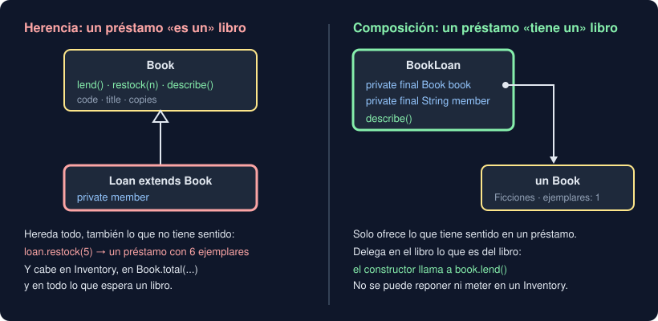

# 05 · Cuándo heredar y cuándo componer

⏱️ 50 min

## 1. Heredar para reutilizar, la tentación

Un préstamo tiene un código de libro, un título y un socio. `Book` ya tiene código, título y `describe()`. Ahorremos trabajo:

```java
class Loan extends Book {
    private final String member;
    ...
}
```

Compila, funciona y es un error de diseño. Con `extends`, `Loan` se lleva **todo** lo de `Book`, también lo que en un préstamo no tiene sentido:

```java
Loan loan = new Loan("BK-042", "Ficciones", 1, "Ana");
loan.restock(5);
// BK-042 · Ficciones · ejemplares: 6 · socio: Ana
```

Un préstamo con 6 ejemplares. Y además, como un `Loan` **es un** `Book`, cabe en el `Inventory`, en `Book.total(...)` y en cualquier método que espere un libro. Nadie lo quería ahí.

## 2. La pregunta: ¿"es un" o "tiene un"?

Antes de escribir `extends`, dilo en voz alta en tu dominio:

| Frase | ¿Es verdad? | Relación |
|---|---|---|
| Un libro raro **es un** libro | Sí: se presta (o no), se describe, tiene ejemplares | Herencia |
| Un préstamo **es un** libro | No: un préstamo **tiene un** libro (y un socio) | Composición |
| Un inventario **es un** libro | No: un inventario **tiene** libros | Composición (semana 06) |



La versión por composición es la de la semana 06:

```java
class BookLoan {
    private final Book book;
    private final String member;

    BookLoan(Book book, String member) {
        book.lend();
        this.book = book;
        this.member = member;
    }

    String describe() {
        return member + " tiene " + book.getTitle() + " (" + book.getCode() + ")";
    }
}
```

`BookLoan` solo ofrece lo que tiene sentido en un préstamo, y **delega** en el libro lo que es del libro (prestar un ejemplar). Si `Book` añade mañana un método nuevo, `BookLoan` no lo hereda sin querer.

## 3. Una subclase cumple las promesas de su padre

"Es un" no basta con que suene bien: tiene que ser verdad **en el comportamiento**. Quien recibe un `Book` cuenta con lo que promete cada método. El de `lend()` es: "presto un ejemplar, o lanzo `IllegalStateException` si no quedan".

```java
class GhostBook extends Book {
    @Override
    void lend() {
        // no hace nada
    }
}
```

`GhostBook` compila y cabe en una variable `Book`, pero no cumple **ninguna** de las dos partes: ni presta ni se niega. Tres préstamos de un libro con 1 ejemplar, y sigue teniendo 1. Un programa que lleve la cuenta con `Book` falla en silencio en cuanto le llega uno.

Compáralo con el `RareBook` que se niega a salir de su sala: lanza `IllegalStateException`, que es justo lo que `Book` ya anunciaba que podía pasar. Quien trate a un `RareBook` como `Book` no se lleva ninguna sorpresa.

La regla, dicha de forma sencilla: **una subclase puede usarse en cualquier sitio donde se use su padre sin que nada se rompa**. Puede ser más estricta dentro de lo prometido (negarse más a menudo, con la misma excepción) y puede añadir cosas, pero no puede dejar de hacer lo que el padre promete. Tiene nombre (principio de sustitución de Liskov) y lo verás con más detalle en la semana 18, con SOLID.

## 4. Primero la composición

La herencia es una relación fuerte: la subclase depende de **cómo** está escrito el padre, no solo de lo que ofrece. En el ejercicio 02, `RareBook` heredaba un `toString()` que llamaba a `describe()`; si `Book` cambia ese detalle, `RareBook` cambia de comportamiento sin que nadie la toque.

Por eso la recomendación clásica es **preferir la composición** y heredar solo cuando se cumplen las tres cosas:

1. La frase "un X **es un** Y" es verdad en tu dominio.
2. X cumple **todo** lo que promete Y: se puede usar en cualquier sitio donde se use Y.
3. X reutiliza de verdad el comportamiento de Y, no solo algunos datos.

Si falla alguna, composición.

## 5. La herencia en tu proyecto

En el proyecto escribes una subclase de tu entidad con una **reserva**: unas últimas unidades que no se sacan nunca. Pasa las tres pruebas:

1. Una entidad con reserva **es una** entidad de tu dominio: tiene código, nombre y unidades, se describe y se repone.
2. Cumple lo que promete tu clase: `take()` saca una unidad o lanza `IllegalStateException`. Se niega más a menudo (cuando solo queda la reserva) y, sin unidades, lanza la **misma** excepción que tu clase, porque llama a `super.take()`.
3. Reutiliza casi todo: la validación del constructor, `restock`, `matches`, `level`, `toString`. Solo sobrescribe `isAvailable`, `take` y `describe`.

Y lo comprobarás con un test: tu `Inventory`, que no sabe nada de reservas, guarda una entidad con reserva y respeta su regla, sin cambiar una línea.

## ✅ Comprueba que lo entendiste

1. ¿Por qué `Loan extends Book` es un error si compila y funciona? Pon un ejemplo de algo que permite y no debería.
2. `GhostBook.lend()` no hace nada. ¿Qué promesa de `Book` rompe? ¿Por qué el `lend()` de `RareBook`, que también se niega a prestar, no la rompe?
3. ¿Por qué tu subclase, sin unidades, debe lanzar la misma excepción que tu clase?

---

## 🔗 Navegación

| Anterior | Actual | Siguiente |
| -------- | ------ | --------- |
| [04 · `protected` y `final`](04-protected-y-final.md) | **05 · Cuándo heredar y cuándo componer** | [Ejercicio 01 · Extender una clase](../2-practicas/ejercicio-01-extender-una-clase/README.md) |
