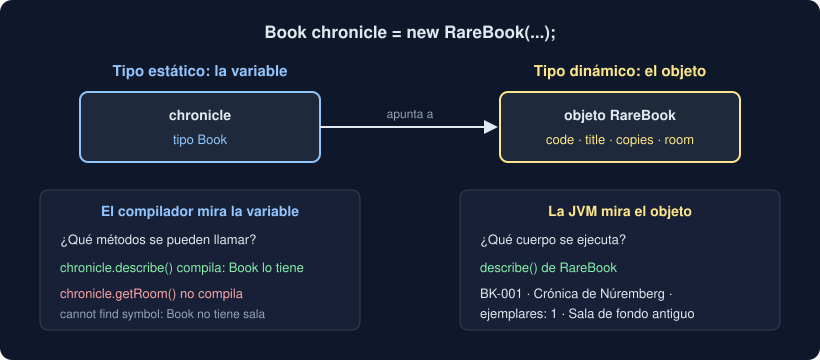

# 01 · Una variable, muchas formas

⏱️ 50 min

## 1. Dos tipos en una línea

En la semana 07 escribiste esto sin darle mucha importancia:

```java
Book chronicle = new RareBook("BK-001", "Crónica de Núremberg", 1, "Sala de fondo antiguo");
```

En esa línea hay **dos tipos**:

| | Dónde se ve | Quién lo usa | Puede cambiar |
|---|---|---|---|
| **Tipo estático**: `Book` | A la izquierda, en la declaración de la variable | El compilador, al compilar | No: la variable es `Book` para siempre |
| **Tipo dinámico**: `RareBook` | A la derecha, en el `new` | La JVM, al ejecutar | Sí: mañana la misma variable puede apuntar a un `Book` normal |

Hasta ahora coincidían (`Book ficciones = new Book(...)`), y no hacía falta distinguirlos. Con la herencia dejan de coincidir, y esta semana entera consiste en saber cuál de los dos manda en cada momento.



## 2. El compilador mira la variable

```java
IO.println(chronicle.getRoom());   // no compila
```

```
error: cannot find symbol
  symbol:   method getRoom()
  location: variable chronicle of type Book
```

El objeto tiene `getRoom()`, pero el compilador no mira objetos: no existen hasta que el programa se ejecuta. Mira la variable, que es `Book`, y un `Book` no tiene sala. **El tipo estático decide qué métodos se pueden llamar.**

## 3. La JVM mira el objeto

```java
IO.println(chronicle.describe());
// BK-001 · Crónica de Núremberg · ejemplares: 1 · Sala de fondo antiguo
```

`describe()` sí está en `Book`, así que compila. Pero al ejecutarse, el `describe()` que corre es **el de `RareBook`**, el del objeto. **El tipo dinámico decide qué cuerpo se ejecuta.**

Las dos reglas juntas:

1. Al compilar: ¿tiene el **tipo de la variable** ese método? Si no, no compila.
2. Al ejecutar: se ejecuta la versión del **tipo del objeto**.

## 4. Subir es automático, bajar no

Guardar una hija en una variable del padre se llama ***upcasting*** (conversión hacia arriba). Es automático y siempre seguro: todo `RareBook` **es un** `Book`, así que cumple todo lo que una variable `Book` promete.

Al revés no:

```java
RareBook fake = new Book("BK-002", "Códice", 1);
// error: incompatible types: Book cannot be converted to RareBook
```

Una variable `RareBook` promete que hay una sala, y un `Book` cualquiera no la tiene. Bajar del padre a la hija (*downcasting*) existe, pero hay que pedirlo y puede fallar: lo verás en la teoría 04.

## 5. Polimorfismo

La palabra viene del griego: "muchas formas". En programación orientada a objetos significa que **una misma llamada puede ejecutar código distinto según el objeto** que la recibe:

```java
Book[] shelf = {
    new Book("BK-042", "Ficciones", 2),
    new RareBook("BK-001", "Crónica de Núremberg", 1, "Sala de fondo antiguo"),
    new AudioBook("BK-500", "Pedro Páramo", 3, 241)
};
for (Book book : shelf) {
    IO.println(book.describe());
}
```

```
BK-042 · Ficciones · ejemplares: 2
BK-001 · Crónica de Núremberg · ejemplares: 1 · Sala de fondo antiguo
BK-500 · Pedro Páramo · ejemplares: 3 · 241 min
```

Una línea, `book.describe()`, y tres formas de responder. El bucle no sabe qué clases hay en el array, y no le hace falta.

Lo mismo vale para los parámetros: un método que recibe `Book` acepta cualquier hija, también las que todavía no existen.

```java
static String label(Book book) {
    return "Ficha de " + book.getCode() + ": " + book.describe();
}
```

En tu proyecto ya lo usas sin saberlo: `Inventory.add(Bicycle item)` acepta tu `ReservedBicycle`, y esta semana también una `TrackedBicycle`.

## ✅ Comprueba que lo entendiste

1. En `Book b = new RareBook(...)`, ¿cuál es el tipo estático y cuál el dinámico? ¿Cuál de los dos puede cambiar si después escribes `b = new Book(...)`?
2. ¿Por qué `b.getRoom()` no compila si el objeto tiene ese método?
3. `label(Book book)` llama a `book.describe()`. ¿Qué `describe()` se ejecuta si le pasas un `AudioBook`? ¿Quién lo decide?

---

## 🔗 Navegación

| Anterior | Actual | Siguiente |
| -------- | ------ | --------- |
| [Semana 08](../README.md) | **01 · Una variable, muchas formas** | [02 · Ligadura dinámica](02-ligadura-dinamica.md) |
