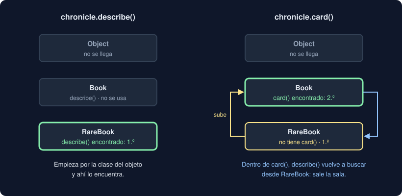

# 02 · Ligadura dinámica

⏱️ 50 min

## 1. Cómo encuentra Java el método

Cuando el programa ejecuta `book.describe()`, la JVM hace lo siguiente:

1. Mira **de qué clase es el objeto** (no la variable).
2. Busca `describe()` en esa clase.
3. Si no está, sube a la clase padre y busca allí. Y así hasta llegar a `Object`.

El primero que encuentra es el que ejecuta. Como la búsqueda empieza por abajo, la versión de la hija gana siempre a la del padre. Esto se llama **ligadura dinámica** (*dynamic binding*): la llamada se "liga" a un cuerpo concreto en el momento de ejecutarse, no al compilar.



## 2. Funciona aunque la llamada esté escrita en el padre

```java
class Book {
    ...
    String card() {
        return "[ " + describe() + " ]";
    }
}
```

`RareBook` no sobrescribe `card()`. Con un `RareBook`:

1. `chronicle.card()`: no está en `RareBook`, sube a `Book` y ejecuta el `card()` de `Book`.
2. Dentro, `describe()` es `this.describe()`, y `this` es el objeto: un `RareBook`. La búsqueda **vuelve a empezar por `RareBook`**, y encuentra su `describe()`.

```
[ BK-001 · Crónica de Núremberg · ejemplares: 1 · Sala de fondo antiguo ]
```

`Book` escribió `card()` sin saber que existirían los libros raros, y aun así les funciona. Ya lo viste en la semana 07 con `toString()`: el de tu clase llama a `describe()`, y en tu subclase sale la reserva. Es el mismo mecanismo.

## 3. Un padre que deja hueco a sus hijas

Ese patrón es muy útil: el padre escribe el **esqueleto** de una operación (`card()`, `toString()`) y llama a métodos que las hijas pueden sobrescribir (`describe()`). Cada hija cambia solo su parte, y el esqueleto no se repite.

En tu proyecto, tu `Inventory` hará lo mismo esta semana:

```java
public int availableCount() {
    int count = 0;
    for (Bicycle item : items()) {
        if (item.isAvailable()) {
            count++;
        }
    }
    return count;
}
```

`availableCount()` es el esqueleto ("cuenta las disponibles"), e `isAvailable()` es la parte que cada objeto responde a su manera. Con una `ReservedBicycle`, la versión que respeta la reserva; con una `TrackedBicycle`, la heredada de tu clase.

## 4. Abierto a clases nuevas, cerrado a cambios

Añade una clase que no existía:

```java
class Magazine extends Book {
    ...
    @Override
    String describe() {
        return super.describe() + " · número " + issue;
    }
}
```

`card()`, el bucle que llama a `card()`, `label(Book)`, tu `Inventory`... todo lo que trabaja con `Book` funciona con `Magazine` **sin cambiar una línea**. Ese código está *abierto* a tipos nuevos y *cerrado* a modificaciones. Es la idea que la semana 18 llamará principio abierto/cerrado (la "O" de SOLID), y el polimorfismo es lo que la hace posible.

## 5. Lo que no tiene ligadura dinámica

No todo se decide al ejecutar. Hay dos cosas que decide el compilador con el tipo de la variable:

| Qué | Por qué | Lo ves en |
|---|---|---|
| Los métodos `static` | Son de la clase, no del objeto: no hay objeto que elija | Este apartado |
| La sobrecarga | El compilador elige por los tipos de los argumentos | Teoría 03 |

Un método `static` con el mismo nombre en la hija **no sobrescribe** el del padre: lo **oculta**.

```java
class Book     { static String origin() { return "la clase Book"; } }
class RareBook extends Book { static String origin() { return "la clase RareBook"; } }

Book chronicle = new RareBook(...);
chronicle.origin();   // "la clase Book": manda la variable
```

Si le pones `@Override`, el compilador te lo dice claro: `static methods cannot be annotated with @Override`. Por eso un `static` se llama con el nombre de la clase (`Book.origin()`), no con una variable: así nadie espera polimorfismo donde no lo hay.

## ✅ Comprueba que lo entendiste

1. `card()` solo está en `Book`. ¿Por qué un `RareBook` muestra su sala al llamarlo? Describe la búsqueda paso a paso.
2. En tu proyecto, ¿qué `isAvailable()` ejecuta `availableCount()` con una `ReservedBicycle`? ¿Y con una `TrackedBicycle`, que no lo sobrescribe?
3. ¿Por qué un método `static` no puede sobrescribirse?

---

## 🔗 Navegación

| Anterior | Actual | Siguiente |
| -------- | ------ | --------- |
| [01 · Una variable, muchas formas](01-una-variable-muchas-formas.md) | **02 · Ligadura dinámica** | [03 · Sobrecarga frente a sobrescritura](03-sobrecarga-frente-a-sobrescritura.md) |
