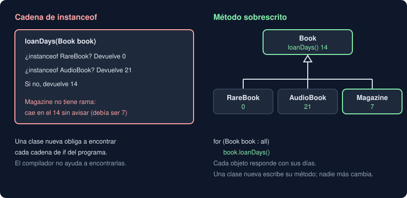

# 05 · Polimorfismo en lugar de condicionales

⏱️ 55 min

## 1. Una regla que depende del tipo

La biblioteca presta cada cosa un número de días: un libro, 14; un libro raro, 0 (no sale); un audiolibro, 21. La primera idea es una función que pregunta:

```java
static int loanDays(Book book) {
    if (book instanceof RareBook) {
        return 0;
    } else if (book instanceof AudioBook) {
        return 21;
    }
    return 14;
}
```

Funciona y se entiende. El problema llega después.

## 2. Llega una clase nueva

Alguien escribe `Magazine extends Book`. Las revistas se prestan 7 días.

```java
Book magazine = new Magazine("RV-007", "Revista de Occidente", 4);
IO.println(loanDays(magazine));   // 14
```

14, y ni un error ni un aviso. `loanDays` no tiene rama para `Magazine` y cae en el `return 14` del final. Y en un programa real no hay una sola función así: está `loanDays`, `lateFee`, `noticeText`, `canBeReserved`... cada una con su cadena de `instanceof`. Cada clase nueva obliga a encontrarlas **todas**, y el compilador no te ayuda a encontrar ni una.



## 3. La regla, dentro de cada clase

Mueve la regla a donde están los datos: un método en `Book`, sobrescrito en cada hija que lo necesite.

```java
class Book {
    int loanDays() {
        return 14;
    }
}

class RareBook extends Book {
    @Override
    int loanDays() {
        return 0;
    }
}

class AudioBook extends Book {
    @Override
    int loanDays() {
        return 21;
    }
}

class Magazine extends Book {
    @Override
    int loanDays() {
        return 7;
    }
}
```

Y quien lo use, solo pregunta:

```java
for (Book book : all) {
    IO.println(book.getCode() + ": " + book.loanDays() + " días");
}
```

Comparado con la cadena de `if`:

| | Cadena de `instanceof` | Método sobrescrito |
|---|---|---|
| Dónde está la regla de `Magazine` | En cada función que pregunte el tipo, lejos de `Magazine` | En `Magazine` |
| Una clase nueva | Hay que encontrar y cambiar cada cadena | Escribe su método; nadie más cambia |
| Si se olvida | Cae en el último `return`, en silencio | Hereda el de `Book`: un valor por defecto escrito a propósito |
| Quién elige la rama | Tu código, preguntando | La JVM, por el objeto |

Esta refactorización tiene nombre: ***replace conditional with polymorphism*** (sustituir un condicional por polimorfismo). La volverás a ver en la semana 18.

## 4. Cuándo un `if` sí es la respuesta

No todo `if` es un polimorfismo escondido. La pregunta es **sobre qué** decides:

- `if (quantity == 0)`, `if (reserve < 0)`: decides sobre un **valor**. Es un `if` normal, y está bien.
- `if (book instanceof RareBook)`, `if (type.equals("rare"))`: decides sobre **qué clase de cosa es**. Ahí suele faltar un método sobrescrito.

Fíjate en el segundo ejemplo: un `String type` con `"rare"` o `"audio"` es la misma cadena de `if` sin herencia. Si tu clase tiene un campo que dice "de qué tipo soy" y varios métodos con `if` sobre él, es candidata a una jerarquía.

## 5. ¿Y si `Book` no debería tener una versión por defecto?

En los ejemplos, `Book.loanDays()` devuelve 14. Pero imagina una jerarquía en la que el padre **no sabe** qué responder: un `Item` genérico del que solo existen hijas concretas. Escribir un `return 0` inventado para que compile sería mentir. Para eso existen las clases abstractas y las interfaces, que dicen "toda hija **debe** escribir este método": es la semana 09.

## 6. La regla en tu proyecto

Tu `Inventory` no pregunta el tipo de nada. `availableCount()` llama a `isAvailable()` y `report()` usa `toString()`, y cada objeto responde con su versión: la reserva, las salidas o tu clase. Si mañana escribes una tercera subclase, tu `Inventory` funciona con ella sin cambiar una línea. Por eso el test `theInventoryNeverAsksForTheType` falla si escribes en `Inventory.java` un `instanceof`, un `getClass` o el nombre de una subclase.

## ✅ Comprueba que lo entendiste

1. ¿Por qué `loanDays(magazine)` devuelve 14 sin ningún error? ¿Qué tendrías que hacer para arreglarlo con la cadena de `if`, y qué con el método sobrescrito?
2. `if (quantity < reserve)` y `if (item instanceof ReservedBicycle)`: ¿cuál es un `if` normal y cuál huele a polimorfismo que falta? ¿Por qué?
3. Tu `Inventory` tiene una `TrackedBicycle`. ¿Qué `isAvailable()` usa `availableCount()` con ella?

---

## 🔗 Navegación

| Anterior | Actual | Siguiente |
| -------- | ------ | --------- |
| [04 · `instanceof` y *casting*](04-instanceof-y-casting.md) | **05 · Polimorfismo en lugar de condicionales** | [Ejercicio 01 · Tipo estático y tipo dinámico](../2-practicas/ejercicio-01-tipo-estatico-y-tipo-dinamico/README.md) |
