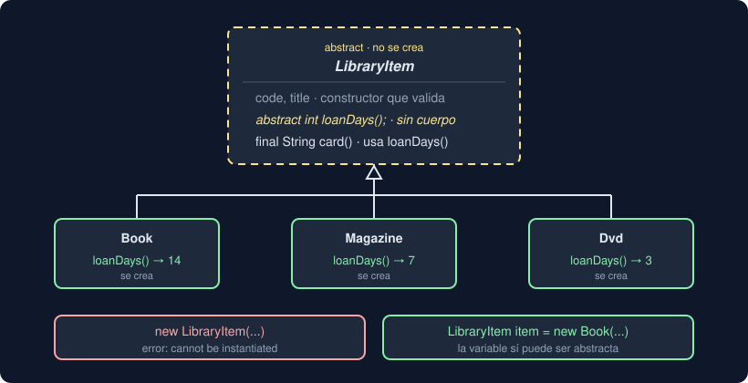

# 01 · Clases abstractas

⏱️ 50 min

## 1. Una clase de la que no hay objetos

La biblioteca presta libros, revistas y DVD. Las tres cosas tienen un código y un título, y las tres se prestan un número de días. Lo común va a una clase padre, como en la semana 07:

```java
class LibraryItem {
    private final String code;
    private final String title;
    ...
    int loanDays() {
        return ???;
    }
}
```

¿Cuántos días se presta "algo de la biblioteca"? No hay respuesta: depende de qué sea. Y si nadie va a crear nunca un `LibraryItem` "a secas", sino siempre un libro, una revista o un DVD, inventar un `return 14` solo para que compile es mentir. En la semana 08 lo dejamos apuntado: para eso existen las clases abstractas.

## 2. `abstract`: la clase y el método

```java
abstract class LibraryItem {

    private final String code;
    private final String title;

    LibraryItem(String code, String title) {
        this.code = code;
        this.title = title;
    }

    abstract int loanDays();          // sin cuerpo: termina en ;

    String card() {
        return code + " · " + title + " · " + loanDays() + " días";
    }
}
```

Dos usos de la misma palabra:

| | Qué significa |
|---|---|
| `abstract class LibraryItem` | No se pueden crear objetos de esta clase. Solo de sus hijas |
| `abstract int loanDays();` | Un método **sin cuerpo**. Cada hija concreta tiene que escribirlo |

Una clase con un método abstracto tiene que ser abstracta: si no, alguien podría crear un objeto con un método que no hace nada. El compilador te lo dice: `missing method body, or declare abstract`.



## 3. Lo que el compilador impide

```java
LibraryItem item = new LibraryItem("XX-001", "Algo");
// error: LibraryItem is abstract; cannot be instantiated
```

Y una hija que no escribe el método abstracto:

```java
class Dvd extends LibraryItem {
    Dvd(String code, String title) {
        super(code, title);
    }
}
// error: Dvd is not abstract and does not override abstract method loanDays() in LibraryItem
```

El mensaje te da las dos salidas: o `Dvd` escribe `loanDays()`, o `Dvd` también es abstracta y deja el método a sus propias hijas. Heredar de una clase abstracta es aceptar un contrato, y el compilador comprueba que lo cumples **antes** de ejecutar nada. Con un `return 14` inventado en el padre, el `Dvd` que olvidara su método se prestaría 14 días sin ningún aviso, como la revista de la semana 08.

## 4. Lo que una clase abstracta sí tiene

Abstracta no quiere decir vacía. `LibraryItem` tiene todo lo de una clase normal:

- **Atributos**, privados, con su encapsulación: `code` y `title`.
- **Constructor**, aunque nadie pueda escribir `new LibraryItem(...)`. Lo llaman las hijas con `super(code, title)`, y es el sitio perfecto para validar lo común una sola vez.
- **Métodos con cuerpo**, como `card()`, que heredan todas las hijas.

Y una variable puede ser de una clase abstracta:

```java
LibraryItem[] shelf = { new Book(...), new Magazine(...), new Dvd(...) };
for (LibraryItem item : shelf) {
    IO.println(item.card());
}
```

Todo lo de la semana 08 sigue valiendo: el tipo estático es `LibraryItem`, el dinámico es el de cada objeto, y `loanDays()` se busca desde la clase del objeto. Lo único nuevo es que **ningún** objeto es un `LibraryItem` a secas.

## 5. Cuándo hacer una clase abstracta

Haz abstracta una clase padre cuando se cumplan las dos cosas:

1. **Nadie la crea por sí sola**: en tu programa solo existen sus hijas.
2. **Hay algo que el padre no sabe responder** y cada hija sí.

Tu clase del proyecto no cumple la primera: en tu sistema existen bicicletas normales, además de las que tienen reserva o cuentan salidas. Por eso no la conviertes en abstracta. `LibraryItem` sí las cumple.

## ✅ Comprueba que lo entendiste

1. ¿Por qué `new LibraryItem(...)` no compila, si `LibraryItem` tiene constructor? ¿Quién llama a ese constructor?
2. Escribes `class Map extends LibraryItem` sin `loanDays()`. ¿Qué dos formas tienes de arreglar el error?
3. ¿Por qué tu clase del proyecto no debería ser abstracta?

---

## 🔗 Navegación

| Anterior | Actual | Siguiente |
| -------- | ------ | --------- |
| [Semana 09](../README.md) | **01 · Clases abstractas** | [02 · El método plantilla](02-el-metodo-plantilla.md) |
