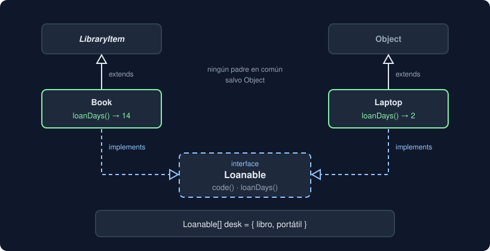

# 03 · Interfaces

⏱️ 55 min

## 1. Un contrato sin familia

La biblioteca también presta portátiles. Un portátil tiene código y días de préstamo, como un libro, pero no es un `LibraryItem`: no tiene título ni autor, y no tiene sentido que herede de la misma clase que los libros. Aun así, el mostrador de préstamos quiere tratarlos igual.

Lo que comparten no es una familia, sino una **capacidad**: los dos se pueden prestar. Eso es una interfaz:

```java
interface Loanable {
    String code();
    int loanDays();
}
```

Una **interfaz** es una lista de métodos que una clase promete tener. No dice cómo se hacen; dice qué se puede pedir. Sus métodos no tienen cuerpo y son `public` aunque no lo escribas.

## 2. `implements`: firmar el contrato

```java
class Laptop implements Loanable {

    private final String code;

    Laptop(String code) {
        this.code = code;
    }

    @Override
    public String code() {
        return code;
    }

    @Override
    public int loanDays() {
        return 2;
    }
}
```

`implements Loanable` es la firma. A partir de ahí, el compilador exige que `Laptop` tenga **todos** los métodos de la interfaz, públicos y con los mismos parámetros. Si falta uno, el mismo error que con una clase abstracta: `Laptop is not abstract and does not override abstract method loanDays() in Loanable`. Si lo escribes sin `public`: `attempting to assign weaker access privileges; was public`.

## 3. La interfaz como tipo

Una interfaz no se puede crear (`new Loanable()` no compila), pero sí sirve como tipo de una variable, de un array o de un parámetro:

```java
Loanable[] desk = { new Book("BK-042", "Ficciones", "Borges"), new Laptop("PC-003") };
for (Loanable item : desk) {
    IO.println(item.code() + ": " + item.loanDays() + " días");
}
```

`Book` y `Laptop` no tienen ningún padre en común salvo `Object`, y caben en el mismo array porque los dos firmaron `Loanable`. Todo lo de la semana 08 vale igual: con una variable `Loanable` solo puedes llamar a lo que promete la interfaz (`desk[0].author()` no compila), y cada objeto responde con su versión.



## 4. Una clase, varias interfaces

Una clase solo puede tener **un** padre (`extends`), pero puede implementar **varias** interfaces:

```java
class Book extends LibraryItem implements Loanable, Searchable {
    ...
}
```

Un libro es un artículo de la biblioteca (su familia), se puede prestar y se puede buscar (sus capacidades). Según la variable con la que lo mires, el compilador te deja llamar a unos métodos u otros:

| Variable | Qué puedes llamar |
|---|---|
| `Book b` | Todo lo de `Book`, lo heredado y lo de las dos interfaces |
| `Loanable l` | `code()` y `loanDays()` |
| `Searchable s` | `matches(text)` |

Por eso un método que solo necesita buscar recibe un `Searchable`, no un `Book`: acepta cualquier cosa buscable, también las que aún no existen. Y no acepta lo que no lo es: pasarle un `Laptop` da `Laptop cannot be converted to Searchable`, aunque `Laptop` tuviera un método `matches`. Cuenta la firma, no el parecido.

## 5. La interfaz de tu proyecto

En tu proyecto, `Criterion` es una interfaz con un método, `accepts(Bicycle item)`. `AvailableCriterion` y `NameCriterion` la implementan, y tu `Inventory` recibe un `Criterion` en `select` y en `count`. El inventario no sabe qué criterios existen: le basta con que el objeto que le llega tenga `accepts`. Mañana escribes un criterio nuevo y el inventario lo usa sin cambiar.

Es la regla que la semana 18 llamará "programar contra interfaces": el código que usa algo pide el contrato más pequeño que le sirve, no una clase concreta.

## ✅ Comprueba que lo entendiste

1. ¿Por qué `Laptop` no hereda de `LibraryItem`, si los dos se prestan?
2. Tienes `Loanable l = new Book(...)`. ¿Puedes llamar a `l.matches("borges")`? ¿Y si la variable fuera `Book`?
3. ¿Qué gana tu `Inventory` recibiendo un `Criterion` en lugar de un `NameCriterion`?

---

## 🔗 Navegación

| Anterior | Actual | Siguiente |
| -------- | ------ | --------- |
| [02 · El método plantilla](02-el-metodo-plantilla.md) | **03 · Interfaces** | [04 · Métodos `default` y `static`](04-metodos-default-y-static.md) |
