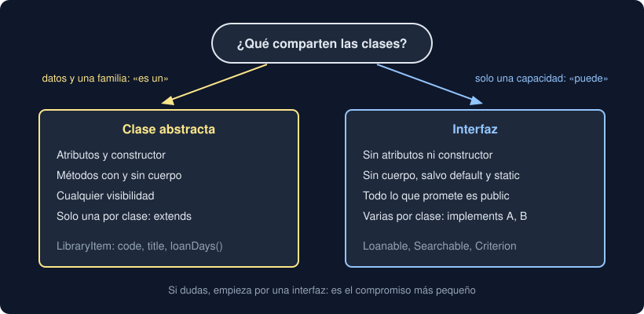

# 05 · Clase abstracta o interfaz

⏱️ 50 min

## 1. Se parecen, pero no son lo mismo

Las dos declaran métodos sin cuerpo que otras clases tienen que escribir, ninguna se puede crear con `new` y las dos sirven como tipo de una variable. La diferencia está en lo que **pueden tener** y en **cuántas** puede usar una clase:

| | Clase abstracta | Interfaz |
|---|---|---|
| Atributos de cada objeto | Sí, con su encapsulación | No: solo constantes `public static final` |
| Constructor | Sí, lo llaman las hijas con `super(...)` | No |
| Métodos sin cuerpo | `abstract` | Todos los que no son `default`, `static` ni `private` |
| Métodos con cuerpo | Sí, de cualquier visibilidad | `default`, `static` y `private` |
| Visibilidad de lo que promete | La que elijas | `public` |
| Cuántas puede usar una clase | Una (`extends`) | Varias (`implements A, B, C`) |
| Qué expresa | "Es un": una familia con datos comunes | "Puede": una capacidad |



## 2. La pregunta que decide

Pregúntate qué comparten las clases:

- **Datos y una familia**: libros, revistas y DVD tienen todos código y título, y todos *son* artículos de la biblioteca. Una clase abstracta guarda esos datos una vez, los valida en su constructor y deja huecos para lo que cambia: `LibraryItem`.
- **Solo una capacidad**: libros y portátiles *se pueden prestar*, y no comparten nada más. Una interfaz: `Loanable`.

Si dudas, empieza por una interfaz. Es el compromiso más pequeño: no le quita a nadie su único `extends`, y una clase puede firmar todas las que necesite.

## 3. Las dos juntas

No es una cosa o la otra. Un diseño muy habitual combina las dos:

```java
interface Loanable {                         // la capacidad
    String code();
    int loanDays();
}

abstract class LibraryItem implements Loanable {   // la familia, con sus datos
    private final String code;
    ...
    @Override
    public String code() {
        return code;
    }
    // loanDays() sigue sin cuerpo: LibraryItem es abstracta y no tiene que escribirlo
}

class Book extends LibraryItem { ... }       // escribe loanDays()
class Laptop implements Loanable { ... }     // fuera de la familia, mismo contrato
```

Quien solo presta trabaja con `Loanable` y acepta libros y portátiles. Quien gestiona el catálogo trabaja con `LibraryItem`. Fíjate en que `LibraryItem` implementa `Loanable` sin escribir `loanDays()`: una clase abstracta puede dejar métodos del contrato a sus hijas.

## 4. Tu proyecto: por qué `Criterion` es una interfaz

`AvailableCriterion` y `NameCriterion` no comparten ningún dato: uno no guarda nada y el otro guarda el texto que busca. No forman una familia; comparten una capacidad, decir si una entidad les vale. Una interfaz es lo que pide. El código común, `count`, cabe en un `default` porque solo usa `accepts`.

Si mañana tuvieras diez criterios que guardan todos un límite y lo validan igual, una clase abstracta `LimitCriterion implements Criterion` con ese atributo y su constructor sería un buen sitio para no repetirlo. Las dos herramientas se complementan.

## 5. Lo que viene

Una interfaz con **un solo** método abstracto, como `Criterion`, se llama **interfaz funcional**. Java tiene una sintaxis corta para implementarlas sin escribir una clase, las *lambdas*, que verás con los *streams* en la fase 3. Y la semana 10 cierra la jerarquía de otra forma: con `sealed` podrás decir exactamente qué clases pueden implementar una interfaz o heredar de una clase.

## ✅ Comprueba que lo entendiste

1. Quieres que todos los artículos de la biblioteca validen su código de la misma forma. ¿Clase abstracta o interfaz? ¿Por qué?
2. Un `Laptop` ya hereda de una clase `Device`. ¿Puede además ser `Loanable`? ¿Y heredar de `LibraryItem`?
3. Explica en una frase por qué `Criterion` es una interfaz en tu proyecto.

---

## 🔗 Navegación

| Anterior | Actual | Siguiente |
| -------- | ------ | --------- |
| [04 · Métodos `default` y `static`](04-metodos-default-y-static.md) | **05 · Clase abstracta o interfaz** | [Ejercicio 01 · Clases abstractas](../2-practicas/ejercicio-01-clases-abstractas/README.md) |
