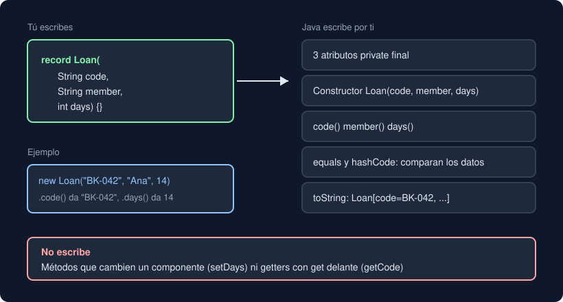

# 01 · Records

⏱️ 50 min

## 1. Clases que solo llevan datos

Algunas clases no hacen casi nada: guardan unos datos, los devuelven y ya. Un préstamo de la biblioteca, por ejemplo: qué libro, para quién y cuántos días.

```java
class LoanCard {

    private final String code;
    private final String member;
    private final int days;

    LoanCard(String code, String member, int days) {
        this.code = code;
        this.member = member;
        this.days = days;
    }

    String getCode() { return code; }
    String getMember() { return member; }
    int getDays() { return days; }
}
```

Son veinte líneas y todavía le falta algo. Dos `LoanCard` con los mismos datos no son iguales (`equals` es el de `Object`, que compara si es **el mismo objeto**), y `println` muestra `LoanCard@25b485ba`. Para arreglarlo habría que escribir `equals`, `hashCode` y `toString` a mano, y acordarse de cambiarlos cada vez que se añade un atributo.

## 2. Un record en una línea

Un **record** es una clase pensada justo para esto: llevar unos datos que no cambian. Se declara con la palabra `record`, el nombre y, entre paréntesis, sus **componentes**:

```java
record Loan(String code, String member, int days) {}
```

Con esa línea, Java escribe por ti todo lo de `LoanCard` y lo que le faltaba:



```java
Loan first = new Loan("BK-042", "Ana", 14);
Loan second = new Loan("BK-042", "Ana", 14);

first.code();            // "BK-042"
first.days();            // 14
first.equals(second);    // true: mismos componentes
IO.println(first);       // Loan[code=BK-042, member=Ana, days=14]
```

Fíjate en el nombre de los métodos de acceso: `code()`, no `getCode()`. Un record llama a cada acceso **como su componente**.

## 3. Los componentes no cambian

Cada componente es un atributo `private final`, y el record no trae ningún método que lo cambie:

```java
first.days = 21;         // error: days has private access in Loan
```

Un `Loan` se queda como se creó. Si necesitas un préstamo de 21 días, creas otro. Es lo que hace un método como este, escrito dentro del record:

```java
record Loan(String code, String member, int days) {

    Loan extended(int extra) {
        return new Loan(code, member, days + extra);
    }
}
```

`first.extended(7)` devuelve un `Loan` nuevo, y `first` sigue con 14 días. Dentro del record, los componentes se usan por su nombre, como cualquier atributo.

Un aviso: `final` impide cambiar **a qué apunta** el componente, no el objeto apuntado. Si un componente es un array, el array no se puede sustituir, pero sus posiciones sí se pueden cambiar desde fuera. Por eso los componentes de un record suelen ser textos, números, *enums* u otros records.

## 4. El constructor compacto

El constructor que escribe Java acepta cualquier cosa: `new Loan("BK-042", "Ana", 0)` crea un préstamo de 0 días. Para validar, escribes un **constructor compacto**: el nombre del record, sin paréntesis, y dentro solo las comprobaciones.

```java
record Loan(String code, String member, int days) {

    Loan {
        if (days <= 0) {
            throw new IllegalArgumentException("Días no válidos: " + days);
        }
    }
}
```

Recibe los mismos parámetros que los componentes, con sus nombres. Si nada lanza una excepción, Java asigna los componentes **al final**, sin que escribas `this.days = days`. De hecho, no puedes escribirlo: `cannot assign a value to final variable days`.

Lo que sí puedes es cambiar el parámetro antes de que se asigne. Así se normaliza un dato:

```java
    Loan {
        code = code.strip().toUpperCase();   // el parámetro, no el componente
    }
```

Es la regla de tu clase desde la semana 06: un objeto mal construido no llega a existir.

## 5. Lo que un record puede y no puede

| Puede | No puede |
|---|---|
| Tener métodos propios, como `extended` | Heredar de otra clase: todo record hereda ya de `java.lang.Record` |
| Implementar interfaces | Tener hijas: un record es `final` |
| Tener métodos y constantes `static` | Tener atributos de objeto aparte de sus componentes |
| Sobrescribir `toString` o un acceso, si hace falta | Cambiar un componente después de crearse |

La segunda fila importa esta semana: como un record no puede tener hijas, el compilador sabe exactamente qué es un `Taken`, sin sorpresas por debajo.

## 6. ¿Record o clase?

Haz una pregunta: **¿este objeto cambia después de crearse?**

- Tu clase principal cambia: `take()` y `restock()` cambian sus unidades. No es un record, y su `equals` de `Object` tiene sentido: dos bicicletas con los mismos datos siguen siendo dos bicicletas.
- El resultado de sacar una unidad no cambia: dice qué pasó, y ya. Dos resultados con los mismos datos significan lo mismo. Es un record, y en tu proyecto serán dos: `Taken(String code, int left)` y `Rejected(String code, String reason)`.

En la semana 11 escribirás `equals` y `hashCode` a mano para tu clase, y verás cuánto te ahorra un record.

## ✅ Comprueba que lo entendiste

1. ¿Qué métodos escribe Java por ti en `record Loan(String code, String member, int days) {}`? ¿Cómo se llama el que devuelve `member`?
2. ¿Por qué `new Loan("BK-042", "Ana", 14).equals(new Loan("BK-042", "Ana", 14))` da `true` y con dos `LoanCard` da `false`?
3. En un constructor compacto, ¿por qué no se escribe `this.days = days`? ¿Qué sí puedes hacer con el parámetro `days`?
4. ¿Por qué tu clase principal no es un record?

---

## 🔗 Navegación

| Anterior | Actual | Siguiente |
| -------- | ------ | --------- |
| [Semana 10](../README.md) | **01 · Records** | [02 · Enums](02-enums.md) |
