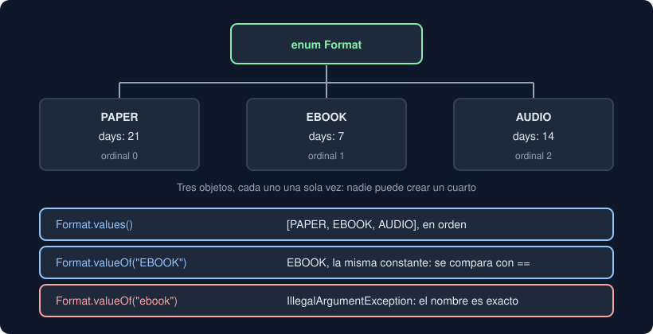

# 02 · Enums

⏱️ 50 min

## 1. Datos con pocos valores posibles

Desde la semana 02, tu `Stock.level` devuelve un texto: `"agotado"`, `"bajo"`, `"normal"` o `"completo"`. Funciona, pero un `String` acepta cualquier texto:

```java
if (Stock.level(quantity, capacity).equals("agtoado")) {   // compila, y nunca es true
    reorder();
}
```

El compilador no sabe que solo hay cuatro niveles, así que no puede avisarte de una errata. Pasa lo mismo con el formato de un libro, el estado de un pedido o la talla de una camiseta: datos con **unos pocos valores fijos**, que conoces cuando escribes el programa.

## 2. Un enum: un tipo con sus valores escritos

Un **enum** (de *enumeration*) es un tipo cuyos valores se escriben en la propia declaración, y no hay más:

```java
enum Format {
    PAPER, EBOOK, AUDIO
}
```

`PAPER`, `EBOOK` y `AUDIO` son las **constantes** del enum. Se escriben en mayúsculas, como toda constante de Java, y se usan con el nombre del tipo delante:

```java
Format format = Format.PAPER;
Format wrong = Format.PAPPER;     // error: cannot find symbol
```

Una variable `Format` solo puede guardar una de las tres constantes (o `null`). La errata del principio ya no compila.

Cada constante es un **objeto**, y existe una sola vez: Java las crea al cargar el enum y nadie puede crear más (`new Format()` da `enum classes may not be instantiated`). Por eso dos constantes se comparan con `==`.

## 3. Lo que trae todo enum

| Método | Qué hace | Ejemplo |
|---|---|---|
| `values()` | Un array con todas las constantes, en el orden en que se declararon | `for (Format f : Format.values())` |
| `valueOf(String)` | La constante con ese nombre exacto; si no existe, `IllegalArgumentException` | `Format.valueOf("EBOOK")` |
| `name()` | El nombre de la constante como texto | `Format.EBOOK.name()` da `"EBOOK"` |
| `ordinal()` | La posición de la constante, desde 0 | `Format.EBOOK.ordinal()` da `1` |
| `toString()` | Lo mismo que `name()`, salvo que lo sobrescribas | `println(Format.EBOOK)` muestra `EBOOK` |

`valueOf` es el puente con el texto que llega de fuera: lo que escribe un usuario o lo que lees de un archivo. Si el texto no es una constante, falla en el momento, en lugar de colarse como un valor raro. No guardes nada que dependa de `ordinal()`: si alguien reordena las constantes, cambia.

## 4. Constantes con datos y métodos

Un enum es una clase, con una lista fija de objetos. Puede tener atributos, un constructor y métodos:

```java
enum Format {
    PAPER(21),
    EBOOK(7),
    AUDIO(14);                        // ; al final de la lista si sigue algo más

    private final int days;

    Format(int days) {                // siempre privado, aunque no lo escribas
        this.days = days;
    }

    int days() {
        return days;
    }
}
```

`PAPER(21)` llama al constructor con un 21. Cada constante guarda sus propios días, y `Format.PAPER.days()` devuelve 21. Los datos viven con la constante, no en un `if` repartido por el programa.



En tu proyecto, `Level` tendrá cuatro constantes, cada una con su etiqueta en español:

```java
enum Level {
    SOLD_OUT("agotado"), LOW("bajo"), NORMAL("normal"), FULL("completo");
    ...
}
```

## 5. `switch` sobre un enum

Desde la semana 02 sabes que un `switch` con flechas (`->`) puede devolver un valor. Sobre un enum, cada `case` es una constante, escrita sin el nombre del tipo:

```java
static String place(Format format) {
    return switch (format) {
        case PAPER -> "la estantería";
        case EBOOK, AUDIO -> "el servidor";
    };
}
```

Si el `switch` devuelve un valor, tiene que tener respuesta para **todas** las constantes. Si falta `AUDIO`, no compila:

```
error: the switch expression does not cover all possible input values
```

Un `default -> "el servidor"` también lo arreglaría, y es una trampa. El día que añadas `VINYL`, el compilador revisa cada `switch` sin `default` y te dice dónde falta el caso nuevo. Los que tienen `default` lo mandan a esa rama en silencio. Sin `default`, el compilador trabaja para ti.

## ✅ Comprueba que lo entendiste

1. ¿Qué error te da el compilador con `Format.PAPPER` que no te daba con `"papper"`?
2. ¿Qué pasa con `Format.valueOf("ebook")`? ¿Por qué es mejor que devolver un valor por defecto?
3. ¿Por qué se pueden comparar dos constantes con `==`?
4. Un `switch` sobre `Format` cubre las tres constantes sin `default`. Añades `VINYL`. ¿Qué pasa al compilar? ¿Y si tuviera `default`?

---

## 🔗 Navegación

| Anterior | Actual | Siguiente |
| -------- | ------ | --------- |
| [01 · Records](01-records.md) | **02 · Enums** | [03 · Tipos sellados](03-tipos-sellados.md) |
