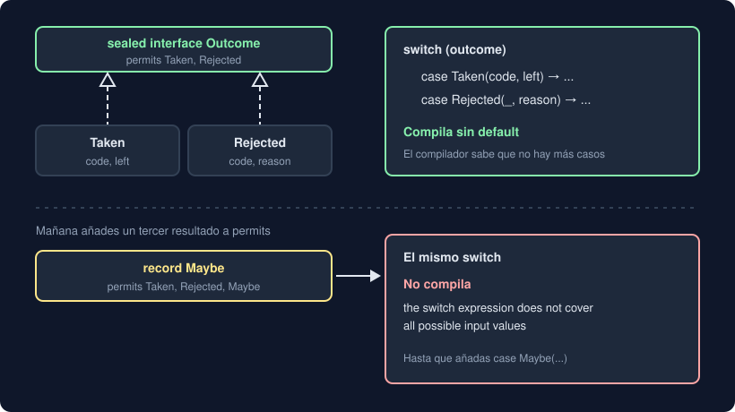

# 03 · Tipos sellados

⏱️ 40 min

## 1. Una jerarquía abierta

En la semana 09, `Criterion` era una interfaz **abierta**: cualquiera podía escribir un criterio nuevo, hasta dentro de un test, y tu `Inventory` lo usaba sin cambiar. Eso era justo lo que querías: no sabes qué criterios harán falta mañana.

Hay otros casos en los que pasa lo contrario. El resultado de sacar una unidad puede ser dos cosas: salió, o no salió. No hay una tercera. Si alguien escribe mañana una clase `Maybe implements Outcome`, no es una ampliación: es un error, porque todo el código que trata resultados piensa en dos casos.

Con una enumeración de **valores** fijos usas un enum. Para una lista fija de **clases**, cada una con sus propios datos, Java tiene los tipos sellados.

## 2. `sealed` y `permits`

Una clase o interfaz **sellada** dice en su cabecera qué clases pueden heredar de ella o implementarla:

```java
sealed interface Outcome permits Taken, Rejected {}

record Taken(String code, int left) implements Outcome {}

record Rejected(String code, String reason) implements Outcome {}
```

`sealed` cierra la jerarquía y `permits` da la lista. Una clase que no está en la lista no entra:

```java
record Maybe(String code) implements Outcome {}
// error: class is not allowed to extend sealed class: Outcome
//        (as it is not listed in its 'permits' clause)
```

Es la misma idea que un enum, pero un nivel más arriba: un `Level` es una de cuatro **constantes**; un `Outcome` es un objeto de una de dos **clases**, y cada una lleva sus datos (un `Taken` sabe cuántas quedan; un `Rejected`, por qué no salió).

## 3. Las hijas también deciden

Cada clase de la lista tiene que decir qué pasa por debajo de ella. Tiene tres opciones:

| Modificador | Qué significa | Ejemplo |
|---|---|---|
| `final` | Nadie hereda de ella: la jerarquía termina aquí | `final class Taken implements Outcome` |
| `sealed` | Vuelve a cerrar, con su propia lista | `sealed class Media extends Item permits Dvd, BluRay` |
| `non-sealed` | Abre de nuevo: cualquiera puede heredar de ella | `non-sealed class Book implements Item` |

Si no escribes ninguno, no compila: `sealed, non-sealed or final modifiers expected`. Los records no necesitan nada, porque ya son `final` (lo viste en la teoría 01). Por eso records y tipos sellados se usan tanto juntos: una interfaz sellada y unos records forman una lista cerrada de formas de datos.

`non-sealed` existe para cuando una rama tiene que quedar abierta, pero úsalo poco: abre un agujero en la lista que el compilador ya no puede vigilar.

## 4. Dónde escribir las clases permitidas

Las clases de `permits` tienen que estar en el **mismo paquete** que la sellada (en tu proyecto, todas están en `gestion`). Si están en el mismo archivo, puedes omitir `permits` y el compilador las encuentra solo; en tu proyecto cada tipo tiene su archivo, así que la lista se escribe.

Si escribes `sealed` y olvidas `permits` con las clases en otros archivos, el compilador no encuentra ninguna permitida y rechaza las que dicen `implements Outcome`.

## 5. Para qué sirve cerrar

Sellar no añade comportamiento. `Taken` y `Rejected` funcionan igual con o sin `sealed`. Lo que cambia es lo que **sabe el compilador**: que todo `Outcome` es un `Taken` o un `Rejected`. Esa información se aprovecha en el `switch`, que es el tema de la teoría siguiente:



Abierta o sellada depende de quién añade los casos nuevos:

- Los criterios los añade **quien usa** tu inventario, sin tocarlo: interfaz abierta.
- Los resultados los decides **tú**, y cuando cambien quieres revisar todo lo que los trata: interfaz sellada.

## ✅ Comprueba que lo entendiste

1. ¿Qué dos palabras de la cabecera cierran `Outcome`, y qué hace cada una?
2. ¿Por qué `Taken` y `Rejected` no necesitan `final`, y una clase normal en la lista sí necesitaría `final`, `sealed` o `non-sealed`?
3. ¿Por qué `Criterion` no es una interfaz sellada?

---

## 🔗 Navegación

| Anterior | Actual | Siguiente |
| -------- | ------ | --------- |
| [02 · Enums](02-enums.md) | **03 · Tipos sellados** | [04 · Pattern matching](04-pattern-matching.md) |
